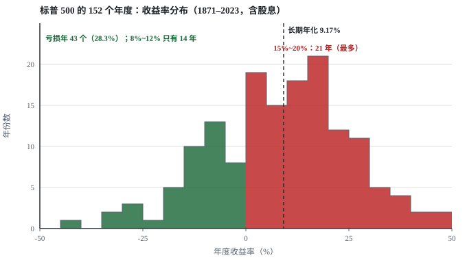
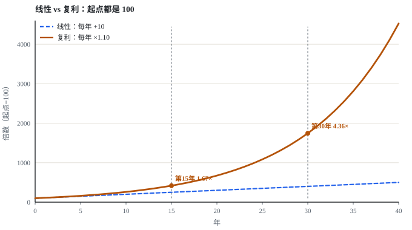
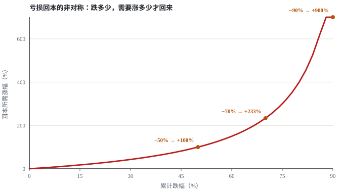
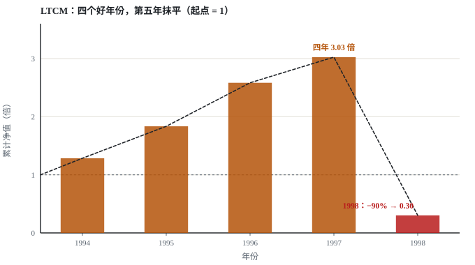
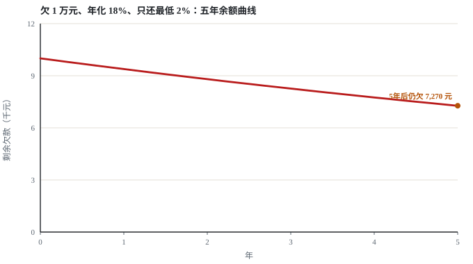
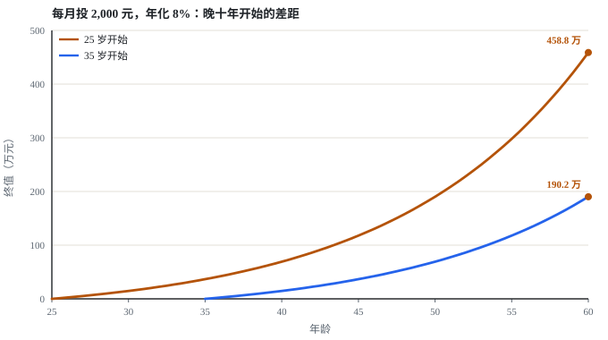
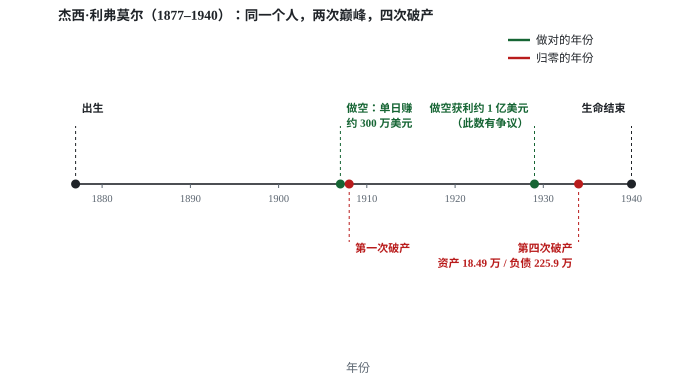
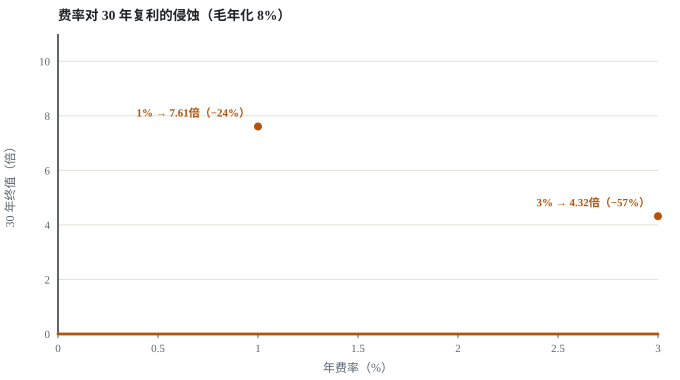

# 没有一种复利叫坚持

**副标题：别把线性当复利**

> 一张表，测出你手上哪些事真的在滚雪球，哪些只是在原地打转。

---

## 这本书想说什么

市面上关于“复利”的说法，九成是错的。错得最厉害的一句是：

> 每天进步 1%，一年后你强大 37 倍。

这句话在数学上没错（1.01³⁶⁵ = 37.78），在现实里是废的。因为它假设了一个不可能的前提：**你可以连续 365 天、每天比昨天强 1%，一天不漏、一天不衰减、且不会因为强了而变难。**

真实世界里，一个 10 万本金的人如果真能做到一年 37 倍，第一年就是 377.8 万，第二年 1.43 亿，第三年 **53.9 亿**。三年进富豪榜。地球上没有这样的人，将来也不会有。

**所以这本书要回答的只有一个问题：**

> 我手上这件事，到底会不会复利？

这个问题可以算，不需要信念。全书给你一套判据——**五个必须同时满足的数学条件**。满足的，才叫复利；缺一条的，就是线性，甚至负的。

---

## 怎么读

**不用从头读。** 这本书是工具书，不是散文。

三条路径，按你现在的情况选：

| 你的处境             | 从哪读                                 |
| ---------------- | ----------------------------------- |
| 刚被人安利了某个“复利计划”   | 直接跳到 [第一部分](#第一部分拆掉五个神话)，找对应的那一条    |
| 想给自己手上的事打分       | 跳到 [第二部分](#第二部分复利成立的五个条件)，拿检验表逐条打   |
| 已经在投钱/在努力，但感觉没效果 | 跳到 [第五部分](#第五部分负复利没人告过你)，先排查是不是方向反了 |

---

## 全书的三个判断（先说结论）

**判断一：能被称作“复利”的事情，比你想象的少得多。**
  
绝大多数人的“长期投入”，在数学上是线性的。线性不可耻，但把它当复利来期待，就会在第七年崩溃——因为你会问自己“我明明这么努力，为什么没有指数增长”。

**判断二：复利最怕的不是收益率低，是归零。**
  
从 −50% 回到原点需要 +100%。从 −100% 回到原点，没有解。所以真实世界里，**“活得久、不爆仓”比“跑得快”重要一个量级**。

**判断三：大多数人真正在经历的，是负复利。**
  
信用卡、坏习惯、声誉、错误的信任。这些按同一套公式在滚动，只是 r 是负的。而它们几乎没人讲。

---

## 一条重要的自我限定

这本书里的判断分三类，我尽量标清楚：

- **【算】** 可以用公式算出来的，比如“−50% 需要 +100% 回本”。这类是硬的
- **【证】** 有公开研究或长期数据支撑的，会标来源和日期。这类有时间戳，会过期
- **【判】** 我的判断，可能错。这类我会说明理由，你自己掂量

**没有第四类。** 凡是既算不出、又没证据、还不承认是判断的句子，这本书里不应该出现。

---

## 目录

### [第一部分：拆掉五个神话](#第一部分拆掉五个神话)

- [1.1 神话一：每天进步 1%，一年 37 倍](#11-神话一每天进步-1一年-37-倍)
- [1.2 神话二：只要坚持，时间会给你答案](#12-神话二只要坚持时间会给你答案)
- [1.3 神话三：复利是线性的加强版](#13-神话三复利是线性的加强版)
- [1.4 神话四：收益率越高越好](#14-神话四收益率越高越好)
- [1.5 神话五：复利只存在于钱上](#15-神话五复利只存在于钱上)

### [第二部分：复利成立的五个条件](#第二部分复利成立的五个条件)

- [2.1 条件一：可累积](#21-条件一可累积)
- [2.2 条件二：正期望，且不被抹平](#22-条件二正期望且不被抹平)
- [2.3 条件三：有足够轮次](#23-条件三有足够轮次)
- [2.4 条件四：边际成本不递增](#24-条件四边际成本不递增)
- [2.5 条件五：不折旧](#25-条件五不折旧)
- [2.6 检验表：给你的每一件事打分](#26-检验表给你的每一件事打分)

### [第三部分：合格的样本](#第三部分合格的样本)

- [3.1 宽基指数：唯一的标准答案](#31-宽基指数唯一的标准答案)
- [3.2 写作与作品：最被低估的一种](#32-写作与作品最被低估的一种)
- [3.3 信用：你没注意到的资产](#33-信用你没注意到的资产)
- [3.4 健康：它不是正复利，是“避免负复利”](#34-健康它不是正复利是避免负复利)
- [3.5 技能：要分清可迁移和不可迁移](#35-技能要分清可迁移和不可迁移)

### [第四部分：效果甚微的那一类](#第四部分效果甚微的那一类)

- [4.1 人脉：有半衰期](#41-人脉有半衰期)
- [4.2 信息摄入：不累积](#42-信息摄入不累积)
- [4.3 单一工具技能：会被迭代抹平](#43-单一工具技能会被迭代抹平)
- [4.4 短期努力：轮次不够](#44-短期努力轮次不够)
- [4.5 为什么“努力”本身不复利](#45-为什么努力本身不复利)

### [第五部分：负复利，没人告过你](#第五部分负复利没人告过你)

- [5.1 债务：数学上的对称破坏](#51-债务数学上的对称破坏)
- [5.2 坏习惯：和戒烟为什么这么难](#52-坏习惯和戒烟为什么这么难)
- [5.3 声誉：衰减极慢，恢复极慢](#53-声誉衰减极慢恢复极慢)
- [5.4 摩擦成本：看不见的那只手](#54-摩擦成本看不见的那只手)
- [5.5 一份自测：你的复利体检表](#55-一份自测你的复利体检表)

### [第六部分：怎么用这本书](#第六部分怎么用这本书)

- [6.1 一张纸的自查清单](#61-一张纸的自查清单)
- [6.2 三个动作，今天就能做](#62-三个动作今天就能做)
- [6.3 三种常见的自我欺骗](#63-三种常见的自我欺骗)
- [6.4 什么时候该承认这件事不是复利](#64-什么时候该承认这件事不是复利)
- [6.5 全书压缩成一张表](#65-全书压缩成一张表)
- [6.6 如果只能记一句话](#66-如果只能记一句话)

### 附录

- [附录 A：关键数字全表](#附录-A关键数字全表)
- [附录 B：算式索引](#附录-B算式索引)
- [附录 C：这本书的算法](#附录-C这本书的算法)
- [附录 D：数据与方法](#附录-D数据与方法)
- [附录 E：参考与延伸](#附录-E参考与延伸)

---

# 第一部分：拆掉五个神话

## 1.1 神话一：每天进步 1%，一年 37 倍

这个说法你一定见过。它通常配一张图：一条平缓的线，和一条冲上天的线。

**先把数算清楚。**

> ### 算式 1 · 每天 1% 的年度倍数
>
> | 项  | 值                         |
> | -- | ------------------------- |
> | 输入 | 每轮增长率 r = 0.01，轮次 n = 365 |
> | 公式 | `终值倍数 = (1 + r)^n`        |
> | 计算 | `1.01 ^ 365 = 37.7834`    |
> | 结果 | **一年 37.78 倍**（+3,678.3%） |
> | 复现 | `tools/calc.py` 第 1 节     |

一个 10 万本金的人，一年后是 377.8 万。

第二年呢？如果是钱，第二年是 1.43 亿。第三年 53.9 亿。

**现在问一个问题：世界上有人做到过吗？**

没有。【证】伯克希尔·哈撒韦 1965–2025 年的每股市值复合年化是 **19.7%**（同期标普 500 含股息 10.5%，数据来自伯克希尔 2025 年报及其致股东信）。而 1.01³⁶⁵ 折成年化是 3,678%——**是它的大约 190 倍。** 它的问题不在收益率高，在于**它假设了一个不存在的东西**。

### 用真实数据看一眼：年化 10% 有多难

【证】下面这组数字来自标普 500 的全收益数据（含股息再投），用的是罗伯特·席勒公开维护的月度数据集，区间 1871-01 至 2023-06，共 152 个完整年度。**这是我能找到的最长一份连续市场记录。**

| 问题                         | 答案                    |
| -------------------------- | --------------------- |
| 152 年的年化                   | **9.17%**（扣通胀后 6.90%） |
| 152 年里，收益率真的落在 8%~12% 的有几年 | **14 年（9.2%）**        |
| 有多少年是亏的                    | **43 年（28.3%）**       |
| 最好的一年                      | 1933 年，**+47.7%**     |
| 最差的一年                      | 1931 年，**−43.8%**     |
| 年度中位数                      | +9.8%                 |

**注意第二行。** 我们说“长期年化 10%”，但实际上 152 年里只有 14 年真的接近 10%。**平均值是一个统计学虚构——它从来没有以“正常年份”的形式出现过。**

那这些年份长什么样？47.7% 的那一年，紧挨着 −43.8% 的那一年。**这个市场最稳定的性质，是它不稳定。**



图上最扎眼的不是两端的极端，是那条虚线的位置：**虚线所在的 8%~12% 这一档，152 年里只发生过 14 次。** 而开头的“每天 1%”折成年化（3,678%），是这张图上最好的一年（+47.7%）的 79 倍。

现在把 3,678% 放回这张表：它不是“比平均好一点”，它是**比 152 年里最好的一年还高 79 倍**（37.78 / 0.477）。而那个最好的一年之所以出现，是因为前一年刚崩掉 43.8%。

**口径要说清**：上面这些是标普 500 的数据，**不是“任何市场”的数据**。它成立，一部分原因是美国在这 152 年里没有经历过本土战争毁灭、恶性通胀或市场彻底关闭。把它当成“全球通用常数”是错的。这一点在 3.1 节会再讲一次。

> 这一段的数字全部由 `tools/market_stats.py` 从原始数据算出，脚本和数据快照都在仓库里，你可以重跑。

### 它错在哪一步

不是算术错，是**假设**错。它偷偷塞进了三个前提：

| 它假设               | 现实            | 违反了哪个条件      |
| ----------------- | ------------- | ------------ |
| 每天都比昨天强 1%        | 人会累、会忘、会退步    | 条件五（不折旧）     |
| 第 365 天和第 1 天一样容易 | 越往上越难，第一公里最便宜 | 条件四（边际成本不递增） |
| 一个人可以连续 365 天无中断  | 生病、搬家、失恋都会打断  | 条件一（可累积）     |

**三条全违反。所以这句话不是“过于乐观”，是“没有意义”。**

### 那“每天 1%”这个数字本身，有没有用

有。但要换个说法：

> **每天进步 1% 的正确用法，不是“一年 37 倍”，而是“一百天后 2.7 倍”。**

> ### 算式 2 · 一百天的倍数
>
> | 项  | 值                     |
> | -- | --------------------- |
> | 输入 | r = 0.01，n = 100      |
> | 计算 | `1.01 ^ 100 = 2.7048` |
> | 结果 | **一百天 2.70 倍**        |
> | 复现 | `tools/calc.py` 第 1 节 |

一百天、2.7 倍，这个量级是可信的。你学一门语言的常用 300 句、练一个乐器的头 20 个和弦、把体重降 5 公斤，都可能在一百天里做到 2~3 倍的“能力提升”。

**注意“能力提升”这四个字加了引号。** 它不是“你的身价变成 2.7 倍”，是“你在这一件事上，能做到一百天前做不到的事”。**这个倍数是我借用的修辞，不是可测量的指标**——如果谁能提出一个能真算出“能力 = 2.7 倍”的口径，我非常愿意改掉这句话。

**所以真正的区别不是“复利 vs 线性”，是“说 365 天的人在骗你，说 100 天的人在帮你”。**

> **本章结论**【判】
>   
> “每天 1%” 这个说法本身没错，错在把周期说成 365 天。任何跟你讲“一年 37 倍”的人，要么没算过，要么在骗你。你可以信 100 天，不要信 365 天。

---

## 1.2 神话二：只要坚持，时间会给你答案

这是鸡汤里最贵的一句话。它出现在所有健身 App、所有学习打卡群、所有创业者的励志演讲里。

**它错在哪：把“必要”说成了“充分”。**

坚持是复利的**必要条件**，不是**充分条件**。就像油门是开车的必要条件——但方向盘打错，踩得越久离得越远。

数学上说得更清楚。设每轮收益为 r，轮数为 n，终值是：

```
终值 = 本金 × (1 + r)^n
```

`n`（坚持）只出现在指数上，`r` 才决定方向。

**而 r 是可以为负的。**

当 r = −5%，坚持 30 年的结果是：

> ### 算式 3 · 负复利：坚持三十年会怎样
>
> | 项  | 值                        |
> | -- | ------------------------ |
> | 输入 | r = −0.05，n = 30         |
> | 计算 | `1 × 0.95 ^ 30 = 0.2146` |
> | 结果 | **只剩 21.5%**，即亏掉 78.5%   |
> | 复现 | `tools/calc.py` 第 5 节    |

**只剩 21.5%。** 这个人坚持了三十年，一天没落，结果亏掉了 78%。

这就是“坚持”的危险之处：**它只是加油门，不管方向。** 方向对，坚持让结果放大；方向错，坚持让错误放大。

### 一个真实的对照

同样是三十年、同样每天投入两小时：

| 这件事              | 大致每轮收益     | 三十年后的状态                         |
| ---------------- | ---------- | ------------------------------- |
| 每天刷两小时短视频        | r ≈ 0（不累积） | 线性：花了 21,900 小时，得到 21,900 小时的娱乐 |
| 每天练一个会被淘汰的工具     | r 先正后负     | 前五年有用，后二十五年归零                   |
| 每天写 500 字公开发布    | r 正，且可累积   | 复利：作品持续被检索到                     |
| 每天记一份工作笔记，不整理不回顾 | r ≈ 0（不累积） | 线性：写了，但用不上                      |

四件事的“坚持程度”一模一样。结果从“归零”到“复利”，差了三档。

**差的是什么？不是毅力，是这件事本身的数学性质。**

> **本章结论**【判】
>   
> 坚持不产生复利，它只是放大你正在做的事。所以**先选对事，再谈坚持**。顺序反了，就是拿最大的力气犯最大的错。

---

## 1.3 神话三：复利是线性的加强版

这是个被广泛误解的地方，而且误解得很隐蔽——因为大家画的图都是对的，只是没看懂。

**线性与复利，不是“强和弱”的关系，是“两种形状”。**

设起点都是 100，一条每期 +10（线性），一条每期 ×1.10（复利）。

> ### 算式 4 · 线性与复利的分水岭
>
> | 项  | 值                                                  |
> | -- | -------------------------------------------------- |
> | 线性 | `100 + 10 × n`                                     |
> | 复利 | `100 × 1.10 ^ n`                                   |
> | 结果 | 第 5 年 1.07×，第 15 年 1.67×，第 30 年 4.36×，第 40 年 9.05× |
> | 复现 | `tools/calc.py` 第 8 节                              |

| 年      | 线性  | 复利    | 复利/线性 |
| ------ | --- | ----- | ----- |
| 第 5 年  | 150 | 161   | 1.07× |
| 第 10 年 | 200 | 259   | 1.30× |
| 第 15 年 | 250 | 418   | 1.67× |
| 第 20 年 | 300 | 673   | 2.24× |
| 第 25 年 | 350 | 1,083 | 3.10× |
| 第 30 年 | 400 | 1,745 | 4.36× |
| 第 40 年 | 500 | 4,526 | 9.05× |



图里那条蓝色的直线和橙色的曲线，前十年几乎重合。**这就是本书副标题说的“别把线性当复利”——不是线性错，是从图上看不出区别。**

看第 5 年：**1.07 倍。几乎看不出来。**

看第 15 年：1.67 倍。你开始觉得“好像有点用”。

看第 30 年：4.36 倍。**这时候你才确定它赢了。**

看第 40 年：9 倍。

### 这张表藏着一个残酷的事实

**复利在前十年，看起来像个骗局。**

如果你在第 5 年做判断，你会得出“复利和线性差不多”的结论，然后放弃。这不是你不够坚持，是**你在曲线还没抬头的时候要求它抬头**。

反过来也成立：**正因为前十年看不出来，所以在这十年里放弃的人，永远看不到后面三十年。**

### 但也要说另一面

线性不是失败。**线性是可预期的、稳定的、不依赖时间的。**

一个时薪制的程序员，收入是线性的：多做一小时多拿一小时钱。这不丢人，这是地球上绝大多数人的处境。

问题只出在：**你把线性的事，当复利来期待。**

### 「第 15~20 年」这句话，我不想让你只信我的判断

上面那个分水岭是我用一组假设数（每期 +10%）算出来的。你完全可以说：换了参数就不成立。

所以这里补一组真实数据的检验。用同一份标普 500 全收益月度数据，把历史切成一万多个不同起点的窗口，看“投多久”到底改变什么：

| 持有期  | 窗口数量  | 其中亏钱的 | 亏损占比     | 中位年化  | 最差         |
| ---- | ----- | ----- | -------- | ----- | ---------- |
| 10 年 | 1,710 | 51    | **3.0%** | 8.66% | **−4.02%** |
| 20 年 | 1,590 | 0     | **0.0%** | 8.10% | +2.05%     |
| 30 年 | 1,470 | 0     | **0.0%** | 9.90% | +3.64%     |

【证】数据区间 1871-01 至 2023-06，月度全收益，脚本 `tools/market_stats.py`。

**这张表要读三件事：**

1. **十年真的可能亏。** 最差的十年窗口是 −4.02%，起点是 1929 年 8 月——大崩盘前一个月。你要是 1929 年开始投，十年后还倒亏。
2. **二十年，样本里一次都没亏过。** 1,590 个窗口，全部为正，最差也有 +2.05%。
3. **但“不亏”不等于“好看”。** 30 年里最差的窗口只有 3.64%（1902-06 → 1932-06），这段时间指数从 8.41 点走到 4.77 点，**价格是负的**，全靠股息再投才拉到 3.64%。

第三点最重要。**它说明 30 年也不是保险箱，只是“从没亏过”。** 而 3.64% 和 14.32%（最好窗口）之间，差的是四倍。

所以“等十五年”这句话的正确版本不是“十五年一定赢”，而是：

> **十年到十五年是亏损概率从 3% 掉到 0 的那一段。过了这一段，你赌的不再是“会不会亏”，而是“能有多少”。**

这个区别很实在。前一个是生存问题，后一个是收益问题。**大部分人在生存问题还没解决的时候，就开始操心收益问题了。**

> **本章结论**【算】
>   
> 复利和线性的分水岭不在第 5 年，在**第 15~20 年**。所以判断一件事值不值得做，不能用“我这五年有没有感觉”当标准。这是全书最重要的一条实操建议。见算式 4，以及上面的十年 / 二十年 / 三十年窗口表。

---

## 1.4 神话四：收益率越高越好

这是最容易让人破产的一句话。

**因为在复利的公式里，收益率的伤害是不对称的。**

看这组数：

> ### 算式 5 · 亏损回本的非对称
>
> | 项  | 值                                                |
> | -- | ------------------------------------------------ |
> | 输入 | 亏损比例 L                                           |
> | 公式 | `回本所需涨幅 = 1 / (1 − L) − 1`                       |
> | 示例 | `L = 0.50` → `1 / 0.5 − 1 = 100%`                |
> | 结果 | −10% 需 +11.1%；−50% 需 +100%；−90% 需 +900%；−100% 无解 |
> | 复现 | `tools/calc.py` 第 5 节                            |

| 亏损    | 需要涨多少才回本  |
| ----- | --------- |
| −10%  | +11.1%    |
| −20%  | +25.0%    |
| −30%  | +42.9%    |
| −50%  | **+100%** |
| −70%  | +233.3%   |
| −90%  | **+900%** |
| −100% | **无解**    |



图里那条红色曲线不是直线，它在右侧越来越陡。**这意味着：越往下亏，每多亏一点，需要的涨幅增加得越快。**

看前两行：−10% 需要 +11.1%。几乎对称，感觉没什么。

看第五行：−50% 需要 +100%。**这是不对称第一次明显显现。**

看第七行：−90% 需要 +900%。**你已经不可能靠自己的能力回来了。**

看最后一行：−100%。**所有累计归零，且不可逆。**

### 为什么这一条能毁掉整个复利

复利的本质是**“上一轮的结果成为下一轮的起点”**。这个机制有个隐含要求：**结果必须还在。**

一旦归零，前面所有的轮次全部作废。不是打折，是作废。

数学上：

```
如果第 N 年本金变成 0，
那么第 1 到 N-1 年的所有复利，贡献为 0。
```

**这解释了为什么“高收益”在复利语境里是危险的词。** 一个每年 +50%、每五年爆仓一次的策略，长期结果不如每年 +8% 的策略。

因为前者在爆仓那年，把之前所有年份的乘法都乘上了 0。

> ### 算式 6 · 爆仓如何抹掉全部复利
>
> | 项        | 值                                           |
> | -------- | ------------------------------------------- |
> | 策略 A     | 每年 +50%，每 5 年爆仓一次（该年 ×0）                    |
> | 策略 B     | 每年 +8%，不爆仓                                  |
> | 20 年结果 A | `1.5^4 × 0 × ... = 0`（若从不爆仓本应是 **3,325 倍**） |
> | 20 年结果 B | `1.08^20 = 4.66 倍`                          |
> | 结论       | **A 的最终结果 = 0。涨得再漂亮，一次 ×0 就全部作废**           |
> | 复现       | `tools/calc.py` 第 5b 节（归零对称性）               |

### 这不是假设，1998 年发生过一次

【证】长期资本管理公司（LTCM）1994 年 2 月成立，创始合伙人是所罗门兄弟的前债券主管 John Meriwether，董事会里有两位后来的诺贝尔经济学奖得主：Myron Scholes 和 Robert Merton（1997 年获奖，原因是期权定价）。

它的业绩，用任何标准都算漂亮：

| 年份             | 净回报（已扣费用）  |
| -------------- | ---------- |
| 1994（成立 10 个月） | +28.5%     |
| 1995           | **+42.8%** |
| 1996           | **+40.8%** |
| 1997           | +17.1%     |

四年，把钱翻了近三倍。**这是全书开头“每天 1%”那类故事的真实版本**——有人真的连续四年做出 40% 上下。


然后，1998 年 8 月 17 日，俄罗斯宣布卢布贬值、主权债务违约。LTCM 的模型认为这种“多个市场同时反向”的概率极低。它错了：全球资金同时涌向流动性，他们做多的一切都在跌，做空的一切都在涨。


**九月初到九月底不到五周，基金净值蒸发约 90%。**

数字对得上账（【证】国际货币基金组织 1998 年工作论文口径）：

- 1998 年初：资本金约 48 亿美元，资产负债表规模约 1,200 亿美元，**杠杆约 25 倍**；表外衍生品名义本金约 1.3 万亿美元


- 到 9 月 23 日：净值只剩约 6 亿美元，仍支撑着超过 1,000 亿美元的头寸，**杠杆变成约 167 倍**
- 9 月 23 日，纽约联储组织 14 家机构注资 **36 亿美元**，换取基金 90% 的股权与管理权

**所以“爆仓”不是归零到 0，而是归零到“你的本金归别人”。** 创始合伙人和外部投资者的 90% 没有了。

这件事在复利框架里有三个必须记住的点：

**第一，他们的四个好年份，被第五年一次性抹平。**
  
28.5%、42.8%、40.8%、17.1% 连乘等于 **3.03 倍**。乘以 0.1，是 **0.30**。**四年白干，还倒亏 70%。**



**第二，他们不是不聪明，是正确的方向遇上了错误的时点。**
  
收敛交易的逻辑本身没错——价差最终确实收敛了。**但他们活不到那天。** 杠杆的作用是：把一个“最终正确”的判断，变成一个“中途出局”的结局。

**第三，模型给出的概率让所有人安心。**
  
有记录称，他们的风控模型认为单月亏损超过 40 亿美元的概率约为 1%。这个数字让他们觉得安全，于是用了 25 倍杠杆。**问题不在于概率算错了，在于他们用杠杆把自己放到了“错了就死”的位置上。** 一个 1% 的事件，遇到 25 倍杠杆，就不是 1% 的事了。

> 这段写在这里，是为了让第 ② 条不只是一条判据。
>   
> **它是一条真的会让四位诺贝尔奖得主级别的团队在五周内出局的判据。**

> **本章结论**【算】
>   
> 复利的敌人不是“低收益”，是“归零”。所以在选择任何长期投入之前，**先问“这件事最坏能坏到什么程度”**，再问“最好能好到什么程度”。顺序很重要。

---

## 1.5 神话五：复利只存在于钱上

这条不是错，是**不全**。

绝大多数人听到“复利”就想到钱。但这套数学不认钱，它认的是**“能作为下一轮输入的结果”**。

凡是符合这个结构的，都会复利：

- 你写的一篇文章，会被别人反复搜到、引用、转载（作品在复利）
- 你的信用记录，会让下一次借钱更便宜（信用在复利）
- 你每天睡够，会让第二天精力更好（健康在复利，而且是双向的）

反过来说，**钱也不是天然就复利的**。一个频繁交易、每次都亏一点手续费的账户，本金在，但复利机制已经被磨损掉了。

### 更值得注意的：负复利

如果一件事的结果是负的，而且能累积，它就在**负复利**。

> ### 算式 7 · 最低还款的五年
>
> | 项  | 值                                              |
> | -- | ---------------------------------------------- |
> | 输入 | 欠款 10,000 元，年化 18%，每月还最低 2%                    |
> | 计算 | 逐月：`余额 = 余额 × (1 + 18%/12) − max(余额 × 2%, 50)` |
> | 结果 | **5 年后仍欠 7,270 元**（期间累计还款 10,457 元）            |
> | 对照 | 同样 10,000 元投 8%：`10,000 × 1.08^5 = 14,693 元`   |
> | 差距 | **7,423 元**（`14,693 − 7,270`，资产减负债）              |
> | 复现 | `tools/calc.py` 第 6 节                          |



图里那条线几乎是一条水平线。**它不是因为你还得少，是因为你还的钱刚够付利息。**

精确地说：五年累计还了 10,457 元，比本金还多，本金却只降了 27%。这就是负复利的形状：**你一直在还，但余额不怎么降。**

同样这 10,000 元如果不欠债、而是投在年化 8% 的地方，五年后是 14,693 元。

**所以这 1 万块有两种五年后的样子：一边是 14,693 元的资产，一边是 7,270 元的负债。净资产差 7,423 元。**

这里容易算错的地方，我特意标出来：**7,423 是“相减”，不是“相加”。** 有人会算成 `14,693 + 7,270 = 21,963`，那是把负债当资产加了。只有当这 1 万块在两条路上**都真的存在过**——你既投了一万、又另外欠着一万——净资产差才会是 21,963。而你手上只有这一万块，两条路只能走一条，差就是 7,423。**这本书里每个数都欢迎你按计算器复核，包括我可能算错的地方。**

### 把它放大三十倍看

上面是 1 万块、五年。换个规模——

【算】同样一笔 1 万元，30 年后：

| 这 1 万元放在哪               | 30 年后           |
| ----------------------- | --------------- |
| 年化 9.17%（标普全收益 152 年均值） | **13.9 万元**（资产） |
| 年化 18%（信用卡循环利息）         | **143 万元**（负债）  |

**两者相差 10.3 倍。** 注意：9.17% 和 18% 只差不到一倍，但 30 年后差了十倍——**这就是指数对你选的 r 有多敏感。**

而且这个对比还偏乐观：上面那一行 9.17% 已经是 152 年的结果，未来未必重复；下面那一行是确定的合同条款。**确定的坏，对上不确定的好，天平在起点就歪了。**

**负复利比正复利狠，不是因为它更“复利”，是因为它的 r 更大、方向还反着。** 你要花几十年才把 1 万变成 13.9 万；负复利三十年就把 1 万变成 143 万，只是这个数字写在欠条上。

### 所以正确的说法是

> 复利不是钱的专利，是**“可累积结果”**的专利。
>   
> 而大多数人手上正在滚的，不是正复利，是负复利。

第五部分专门讲这个。

---

# 第二部分：复利成立的五个条件

这一部分是全书的核心。**五条必须同时满足，缺一条就不成立。**

不是“打多少分及格”，是**“缺一条就出局”**。因为它们之间不是加权关系，是串联关系——像一根链条，最弱的那一环决定强度。

---

## 2.1 条件一：可累积

### 判据

**上一轮的结果，能不能作为下一轮的输入？**

这一条最容易被忽略，因为它听起来太显然。但恰恰是它筛掉了大部分“努力”。

### 自测问题

> 做第 100 次的时候，第 1 到第 99 次的成果还在起作用吗？

如果答案是“不在，每次都要重新开始”，那么这件事**不可能复利**，无论你多努力。

### 三个例子

**✅ 可累积：写作**

你写的第 1 篇文章，十年后还有人能搜到。第 100 篇发布时，前 99 篇还在替你工作。**结果留在了场上。**

**❌ 不可累积：刷信息流**

你今天看了 200 条资讯。明天从零开始。昨天的 200 条不构成今天的起点。**这不是复利，这是消耗。**

**⚠️ 看起来能累积，实际不能：不回顾的工作笔记**

你记了三年笔记，但从来不整理、不检索。那么第 1,000 条笔记的价值和第 1 条一样——因为它从未被调用。**存起来不等于累积起来。**

### 这一条的常见误判

很多人把“我学了很多”当成累积。**不对。** 累积的判据是**“有没有被下一次使用”**，不是“有没有被存下来”。

一个残酷的换算：你硬盘里躺着 500 本电子书，和读过并用了其中 5 本，后者才叫累积。

---

## 2.2 条件二：正期望，且不被抹平

### 判据

**两个要求，缺一不可：**

1. **期望收益为正**（E(r) > 0）
2. **不存在归零风险**（任何单轮的损失不可能是 −100%）

第 2 条比第 1 条重要得多，原因在 [1.4](#14-神话四收益率越高越好) 已经算过：**−100% 会让前面所有轮次的乘法变成 0。**

### 自测问题

> 这件事最坏的情况是什么？会不会有一条路，让前面的积累全部作废？

如果答案是“会”，那么无论期望多高，这件事都**不适合作为长期复利载体**。

### 正例与反例

**✅ 宽基指数**

单只股票可以归零，指数不会。因为指数会换血——差的公司被剔除，好的公司被纳入。**这是结构性设计带来的“不归零”。**

**❌ 单只个股长期重仓**

期望可能为正，但**不满足第 2 条**。一家公司可以退市、可以造假、可以技术性破产。这不是“小概率”，这是“必然会发生的小概率”。

**❌ 高频交易**

两个条件都不满足。扣掉手续费和滑点后期望常为负；而且杠杆会让归零成为可能。

### 一个容易搞混的地方

**“波动”不是“归零风险”。**

- 价格从 100 跌到 60 再回到 120，这是波动，复利机制完好
- 公司破产清算，这是归零，复利机制死亡

**所以“能不能扛住波动”和“会不会归零”是两个不同的问题。** 前者是心理问题，后者是结构问题。**结构问题无解，心理问题可以练。**

---

## 2.3 条件三：有足够轮次

### 判据

**在你可用的时间窗口内，能不能走完足够多的轮次？**

[1.3](#13-神话三复利是线性的加强版) 算过：**复利和线性的分水岭在第 15~20 年。** 如果你的窗口只有 5 年，那么即使这件事完美满足前两条，你也等不到复利显现。

**真实数据也认这个结论。** 标普 500 全收益的 1,710 个滚动十年窗口里，有 3.0% 是亏的；1,590 个滚动二十年窗口里，一个亏的都没有。**这就是“轮次”的物理形态：它改变的不是收益率，是“你会不会输”。**

### 自测问题

> 这件事我能做多少轮？轮次乘以每轮周期，跨度够不够 15 年？

### 一个反直觉的推论

**“周期越短的事，越容易复利。”**

- 一天一轮（比如写作、练习）：一年 365 轮
- 一年一轮（比如年度考核、年终奖）：三十年 30 轮
- 十年一轮（比如创业退出）：一辈子 3 轮

**轮次少，复利的指数优势就无从体现。** 这就是为什么“一辈子赌一次创业”在数学上不是复利策略，是彩票。

### 时间的作用有多大

同样年化 8%、每月投 2,000 元：

> ### 算式 8 · 晚开始十年，代价有多大
>
> | 项                | 值                                                  |
> | ---------------- | -------------------------------------------------- |
> | 公式               | `FV = 月投 × [((1 + r/12)^n − 1) / (r/12)]`，r = 0.08 |
> | 25 岁起（n = 420 月） | 投入 84 万 → **458.8 万**                              |
> | 35 岁起（n = 300 月） | 投入 60 万 → **190.2 万**                              |
> | 结果               | 投入少 29%，终值少 **59%**，差距 **2.41 倍**                  |
> | 复现               | `tools/calc.py` 第 4 节                              |

| 开始年龄 | 到 60 岁 | 投入本金 | 终值          | 终值/投入  |
| ---- | ------ | ---- | ----------- | ------ |
| 25 岁 | 35 年   | 84 万 | **458.8 万** | 5.46 倍 |
| 35 岁 | 25 年   | 60 万 | **190.2 万** | 3.17 倍 |



两条线的开口不是慢慢拉开的，是在最后十年突然张开。**这就是为什么“什么时候开始”比“开始后多努力”重要。**

**晚开始十年的人，总投入少了 29%，终值却少了 59%。**

这就是“时间在复利里的权重”。它不是“早点开始比较好”这种软建议，是**数学上的硬差距**——2.41 倍。

---

## 2.4 条件四：边际成本不递增

### 判据

**做到第 100 次，成本（钱、时间、精力）会不会显著高于第 1 次？**

如果成本同步增长，那么净收益是“收益 − 成本”，两条线都在涨，结果可能是**线性甚至递减**，而不是复利。

### 自测问题

> 我从第 1 次做到第 100 次，每一次的平均成本是持平、下降，还是上升？

### 例子

**✅ 成本递减：写作、代码、内容**

第 1 篇文章花了 8 小时。第 100 篇可能只要 2 小时，而且质量更好。**因为技能在累积，成本在下降。这是复利最理想的形状。**

**❌ 成本递增：靠意志力维持的事**

第 1 天早起很容易，第 100 天靠的是硬撑，第 1,000 天需要动用越来越多的心理资源。**成本在涨，所以净收益在缩。**

**❌ 成本同步增长：靠人力堆规模的生意**

每多一个客户，就多一份人力成本。收入线性增长，成本也线性增长，**利润是平的。**

### 这一条为什么容易漏

因为大部分人只看“收益涨了没”，不看“成本涨了没”。

一个年收入从 20 万涨到 40 万的人，如果工作时间从 8 小时变成 14 小时，他的**时薪没变**。这不是复利，这是用健康换钱——而且健康那一侧在负复利。

**判断复利的正确口径是“单位投入的产出”，不是“总产出”。**

---

## 2.5 条件五：不折旧

### 判据

**如果停止投入，已经积累的东西会衰减多快？**

这是最容易被忽略的一条，因为它问的是“停下来会怎样”——而人在做规划时，默认自己不会停。

### 自测问题

> 我停三个月，之前的积累还剩多少？

### 衰减速度的谱系

| 类型      | 停三个月的后果          | 衰减速度         |
| ------- | ---------------- | ------------ |
| 指数基金份额  | 一份不少（价格会波动，但份额在） | **几乎不衰减**    |
| 已发表的作品  | 还在被人搜到           | **不衰减，甚至升值** |
| 信用记录    | 基本无损（不良记录才有年限）   | 慢            |
| 外语口语    | 明显退步             | 中            |
| 肌肉量     | 可测量地下降           | 中偏快          |
| 人脉关系    | 明显变淡             | **快**        |
| 短期记忆的知识 | 大量遗忘             | **极快**       |

### 这一条决定了很多事的真实等级

**写作排在复利榜首，很大程度上是因为它在第 5 条上拿了满分。** 你写完的东西不会因为你停了三个月就消失——它留在公开网络上，持续被检索。

**反过来，人脉排不进第一梯队，也正是因为第 5 条。** 关系需要维护才能维持，停三个月就淡了一层。**它不是“复利”，它更接近“订阅制”——不续费就停服。**

> **这一条的推论**【判】
>   
> 判断一件事值不值得长期投入，问自己一句：**“我停下来之后，已经积累的还在不在？”**
>   
> 在的，可以重仓。不在的，要么持续付费，要么别指望它复利。

---

## 2.6 检验表：给你的每一件事打分

### 使用方法

对每件事，逐条问一个“是非题”。**五条全“是”才叫复利。任何一条“否”，这件事就不是复利载体。**

不是打分制，是**否决制**。因为它们是串联的。

### 检验表

| # | 条件        | 是非题                        | 是 | 否 |
| - | --------- | -------------------------- | - | - |
| ① | 可累积       | 做第 100 次时，前 99 次的成果还在起作用吗？ | ☐ | ☐ |
| ② | 正期望 + 不归零 | 期望为正，且不存在让积累全部作废的路径吗？      | ☐ | ☐ |
| ③ | 足够轮次      | 在我可用的时间里，能走完 15 年以上的等效轮次吗？ | ☐ | ☐ |
| ④ | 边际成本不递增   | 第 100 次的单位成本 ≤ 第 1 次吗？     | ☐ | ☐ |
| ⑤ | 不折旧       | 停下来三个月，已积累的还在吗？            | ☐ | ☐ |

### 结果怎么读

| 满足条数    | 结论       | 该怎么做                     |
| ------- | -------- | ------------------------ |
| **5 条** | **真复利**  | 重仓，做二十年，别中途换赛道           |
| 4 条     | 条件性复利    | 找出缺的那条，看能不能补。补不了就按线性期待   |
| 3 条     | 准线性      | 可以做事，但别指望指数增长。按线性规划收益    |
| 2 条及以下  | **不是复利** | 要么当消费（图开心），要么改造它         |
| 第 ② 条为否 | **红线**   | 无论其他四条多好，都不要重仓。这是唯一的一票否决 |

### 为什么第 ② 条是一票否决

因为它是唯一一条**不可逆**的。

其他四条做不到，你只是“增长慢一点”或“白干一场”，损失的是时间。
  
第 ② 条做不到，你损失的是**本金**，而本金是下一轮的输入。

**时间可以再挣，本金不能。**

### 三件事的实战打分

**例 1：每月定投宽基指数**
  
① 是（份额累积）② 是（指数不归零）③ 是（可做三十年）④ 是（成本固定）⑤ 是（份额不折旧）
  
→ **5/5，真复利**

**例 2：每天写 500 字公开发布**
  
① 是（作品累积）② 是（无归零风险）③ 是（一天一轮）④ 是（越写越快）⑤ 是（作品不消失）
  
→ **5/5，真复利**。注意：这一条很多人想不到，因为它看起来“不赚钱”。

**例 3：每天刷两小时短视频**
  
① 否（不累积）② —（无收益，谈不上期望）③ 是 ④ 否（边际成本恒定但收益为零）⑤ 否
  
→ **1/5，不是复利，是消费**。消费不丢人，但别把它记在“投资自己”的账上。

---

# 第三部分：合格的样本

## 3.1 宽基指数：唯一的标准答案

**打分：5/5。**

这是全书唯一一个我认为“五条全满、且普通人就能做到”的样本。

| 条件          | 满足情况                 |
| ----------- | -------------------- |
| ① 可累积       | 份额累积，分红再投则份额自动增加     |
| ② 正期望 + 不归零 | 长期期望为正；指数定期换血，不会整体归零 |
| ③ 足够轮次      | 可以投三十年，一天都不用停        |
| ④ 边际成本不递增   | 定投的手续费和时间成本固定甚至下降    |
| ⑤ 不折旧       | 份额一份不少               |

### 它为什么能“不归零”

这是关键。**单个公司可以死，指数不会死。**

因为指数的编制规则是动态的：差的公司被调出，好的公司被调入。**道琼斯工业指数 1896 年首次发布时的 12 只成分股，今天已全部不在名单上**——只有通用电气（GE）撑到了 2018 年才被剔除。但指数还在，而且涨了很多倍。

**这个“换血”是理解条件 ② 的关键：指数的不归零不是因为它里面没有倒霉的公司，而是因为倒霉的公司会被换掉。** 你今天买的指数，十年后里面的公司已经换了一批。**你买的不是一篮子公司，是一套筛选规则。**

**这是“制度性的不归零”——不是运气好，是设计出来的。**

### 但必须说清它的三个限定

**【证】先把数据摆全。** 以下全部来自前面那份 1871-01 至 2023-06 的标普 500 全收益月度数据，脚本 `tools/market_stats.py`：

| 指标               | 数值                                          |
| ---------------- | ------------------------------------------- |
| 152 年名义年化（含股息再投） | **9.17%**                                   |
| 扣通胀后实际年化         | **6.90%**                                   |
| 年度亏损次数           | 43 / 152（28.3%）                             |
| 最大回撤（名义价格）       | **−84.8%**（1932 年 6 月谷底）                    |
| 回撤 ≥20% 的次数      | **14 次**                                    |
| 每个年代的 25 年年化     | 7.41% / 7.50% / 10.00% / **14.97%** / 7.40% |

**倒数第二行要多看一秒：−84.8%。** 不是 −50%，是 −84.8%。这意味着一个 100 万的账户会跌到 15 万。**这不是“可能的极端情况”，这是真实发生过的。**

最后一行更值得看：五个年代的 25 年年化，从 7.40% 到 14.97%，差了一倍。**“长期年化 9%”这个数字，是把这五个完全不同的时代平均出来的。** 你活在哪一段，决定了你实际拿到 7% 还是 15%。

三个限定：

1. **它需要足够长的时间**。十年窗口有 3.0% 的概率是亏的，二十年窗口一个没亏过
2. **它需要承受回撤**。−84.8% 是真实发生过的，不是假设。**能不能扛住，取决于你有没有在最低点被迫卖出**
3. **它是平均，不是最优**。你放弃了“赢过市场”的可能，换取“不掉队”的确定性

### 还有一个常被跳过的限定：这不是“任何市场”

【判】上面所有数字都是**美国市场**。它成立，有很具体的原因：美国在这 152 年里没有经历过本土战争毁灭、没有经历恶性通胀、市场没有长期关闭、也没有更换过政治制度。

**这不是“美股特别好”，这是“样本里只有美股有这种连续记录”。** 有研究认为美国是二十世纪市场里的幸存者偏差样本——一个赢了的国家，它的历史被记录得最完整。

所以正确的读法是：

> **9.17% 不是一个可以期待的数，它是一个已经发生的数。**
>   
> 它的作用是告诉你“复利在真实世界大概是什么量级”，不是告诉你“你也能拿到 9.17%”。

这个区别很重要。前者是历史，后者是承诺。

### 为什么它仍然是最好的答案

因为**大多数人的问题不是“收益不够高”，是“活不到复利显现的那天”。**

宽基指数最大的价值不是收益率，是**它几乎不可能让你归零**。而这一条，在五条件里恰好是最重要的一条。

**注意“几乎”两个字。** 上面那些数字不能证明“永不归零”——一个市场可以被关闭、被没收、被战争抹掉。**条件 ② 在任何真实资产上都是“概率极低”，不是“数学上不可能”。** 说“不可能”的人是在骗你；说“概率低到你愿意承担”的人，是在跟你说实话。

### 补一个常被追问的问题：买贵了怎么办

“长期年化 9%”说得轻巧，但如果你正好买在 1929 年、2000 年、2007 年呢？

这个问题可以用同一份数据回答。按买入时的席勒 PE10（十年平均市盈率，衡量“贵不贵”）把历史月份分成十档，看每档之后 20 年的年化中位数：

| 档位      | 买入时 PE10    | 之后 20 年年化中位数 |
| ------- | ----------- | ------------ |
| D1（最便宜） | 4.8 – 8.5   | 7.69%        |
| D2      | 8.5 – 10.6  | **14.20%**   |
| D3      | 10.6 – 12.0 | 12.67%       |
| D4      | 12.0 – 13.9 | 10.71%       |
| D5      | 13.9 – 15.6 | 8.23%        |
| D6      | 15.6 – 17.2 | 7.82%        |
| D7      | 17.2 – 18.7 | 7.58%        |
| D8      | 18.7 – 20.9 | 7.52%        |
| D9      | 20.9 – 23.6 | 8.01%        |
| D10（最贵） | 23.7 – 44.2 | 7.01%        |

【证】`tools/market_stats.py` 第 7 节。样本是全部有 PE10 的月份推出的滚动 20 年窗口。

**这张表有两个反直觉的地方，都必须说：**

**第一，最贵的一档（D10）不是灾难，是 7.01%。** 比最便宜档只差 0.68 个百分点。你没看错——**买了历史上最贵的十分之一时段，二十年后依然是赚的，只是赚得少一点。** 这不是说“估值无所谓”，是说“贵”的影响远小于“时间够不够长”。

**第二，最便宜的一档（D1）并不是最好的，只有 7.69%。**
  
原因很实在：D1 的 113 个月里有 82 个月落在 1910 年代和 1920 年代——**买的时候确实便宜，但紧接着是 1929。** 便宜往往不孤立地出现，它常常和“接下来要出事”绑在一起。

而 D2 的 14.20% 是最高的一档，它主要是 1970 年代末和 1980 年代初——那是**通胀高、估值低、之后赶上二十年长牛**的组合。这有很大运气成分，别当规律。


**所以这张表真正的结论不是“低买高卖”，是：**

> 20 年的尺度上，你买得多贵大概只值 3 个百分点的差距（7.01% 对 10.71%，看 D4 到 D10 这一段）。
>   
> **而“不在 20 年内被迫卖出”，值的是 0 个百分点的亏损对 3% 的亏损——是能不能的问题。**

> 这里必须标一条【判】：PE10 只对美股有大样本支持，且“高估值对应低未来收益”这个关系在近年明显弱化。**这张表适合当“别太担心买贵”，不适合当择时信号。**

---

## 3.2 写作与作品：最被低估的一种

**打分：5/5。**

这一条可能会让很多人意外，因为它通常不被列进“复利”清单。

| 条件          | 满足情况                      |
| ----------- | ------------------------- |
| ① 可累积       | 每篇作品都是独立的、可被检索的资产         |
| ② 正期望 + 不归零 | 单篇可能没人看，但不存在“一篇文章让前面全部作废” |
| ③ 足够轮次      | 一天一轮，一年 365 次             |
| ④ 边际成本不递增   | 越写越快、越写越好                 |
| ⑤ 不折旧       | **这一项它拿了满分**              |

### 关键在第 ⑤ 条

一篇文章写完之后，**你不用管它，它还在工作。**

有人在三年后搜到它、引用它、转发它。你睡觉的时候，它还在被阅读。

这一点和“上班”形成了根本区别：**上班的产出在你下班那一刻就停止产生价值了。作品不会。**

### 它复利的是什么

不是粉丝数，是**三个东西的叠加**：

1. **能力**：写 100 篇之后，你的思考结构变了（这是能力复利）
2. **可检索的存量**：100 篇里的任意一篇，随时可能被某个陌生人看到（这是资产复利）
3. **信任**：一个人连续三年输出同类内容，读者会形成预期（这是声誉复利）

**三者叠加，才叫复利。只有第 1 个，那叫“练习”，也很值钱，但不是复利。**

### 一个诚实的限定

【判】**写作的复利不是必然的，它依赖“公开发布”这个动作。**

存在硬盘里的日记、写给自己看的笔记，**第 ⑤ 条就不满足了**——因为没有被检索的可能，它不会在你停下来之后继续工作。

复利需要一个“场”，让成果留在场上。**公开发布就是那个场。**

---

## 3.3 信用：你没注意到的资产

**打分：5/5。**

这是最被低估的一项，因为它不显示在任何账户余额里。

| 条件          | 满足情况                |
| ----------- | ------------------- |
| ① 可累积       | 每一次按时履约，都会进入记录      |
| ② 正期望 + 不归零 | 一次违约不会让之前全部作废，但影响期长 |
| ③ 足够轮次      | 一辈子都在轮              |
| ④ 边际成本不递增   | 维护成本极低（按时还款而已）      |
| ⑤ 不折旧       | **良性记录不衰减**         |

### 它是怎么复利的

信用的复利体现在**“下一次的成本”**上：

- 信用好的人，房贷利率可能低一点
- 信用好的人，可以拿到更高的额度、更长的账期
- 信用好的人，租房、甚至某些求职场景都更顺

**每一次守约，都在降低你未来所有融资行为的成本。** 这是复利，因为它是“上一轮结果成为下一轮起点”的典型结构。

### 它的不对称在哪

**信用的负复利比正复利快得多。**

建立需要几年，破坏只需要一次。而且要修复，得等记录期过去——**这段时间你没法加速，只能等。**

这就是复利机制的一个普遍特征：**上升慢，下降快。** 因为上升需要连续多轮的正收益，下降只需要一轮的 −100% 级别的打击。

---

## 3.4 健康：它不是正复利，是“避免负复利”

**打分：4/5。** 但它非常重要，重要到值得单独讲。

| 条件          | 满足情况             |
| ----------- | ---------------- |
| ① 可累积       | 是（身体状态是可累积的）     |
| ② 正期望 + 不归零 | **部分满足**：某些损伤不可逆 |
| ③ 足够轮次      | 是（每天一轮）          |
| ④ 边际成本不递增   | 是（习惯化之后成本下降）     |
| ⑤ 不折旧       | 否（不练就退）          |

### 为什么它不是满分

因为**健康的上限是“不亏损”，不是“增值”**。

你不可能靠睡觉睡出一个超人的身体。健康的本质是：**你每天都在避免让身体变差。**

这在数学上和“投资”是反的：

- 投资：目标是 +8%/年
- 健康：目标是 **−0%/年**

**它的价值不在“赚”，在“不让本金缩水”。** 而本金缩水是负复利，所以健康其实是在**阻止负复利**。

### 这个区别为什么重要

因为它改变你的期待和做法：

- 如果把它当“投资”，你会追求“变得更强”，然后因为看不到明显进步而放弃
- 如果把它当“止损”，你只需要做到“不比昨天更差”，这个门槛低得多，也更容易坚持二十年

**“不变得更差”是可以做到的，“变得更好”很难持续。** 选前者。

### 一个具体的例子

【判】戒烟这件事，在复利框架下的正确理解不是“戒烟让我更健康”，而是：

> **吸烟是一个每天在滚动的负复利。停下来，是让这个滚动停止，而不是启动一个正向增长。**

这个框架的好处是：它不需要你相信“戒烟会让你变超人”，它只需要你承认“每天都在扣钱”。**而停止扣钱，本身就已经是收益。**

---

## 3.5 技能：要分清可迁移和不可迁移

**打分：3/5 或 5/5，取决于哪一种。**

技能不是一个东西，是两类东西。它们在第 ⑤ 条上完全相反。

### 可迁移技能（5/5）

**定义：换一个场景，它还在。**

比如：

- 结构化表达（写清楚一件事）
- 基础的统计与概率直觉
- 一门外语的通用能力
- 与人协作、把复杂问题拆开

这些技能的**折旧极慢**。你停三年，捡起来还是你的。

**它们复利，因为它们能在新场景里被复用——而“复用”就是“上一轮结果成为下一轮输入”。**

### 不可迁移技能（3/5 或更低）

**定义：换个工具或平台，它就废了。**

比如：某个具体软件的快捷键、某个平台的运营套路、某个框架的特定写法。

它们不是没用——**在当下很有用**。但它们在条件 ⑤ 上有结构性缺陷：**技术一迭代，积累归零。**

**归零就意味着前面所有轮次作废。** 这是条件 ② 的边缘情况。

### 一个判断方法

> 问自己：**“如果明天这个工具消失了，我学到的东西还剩多少？”**

剩下的部分，是可迁移的，值得重仓。
  
不剩的部分，是工具绑定，**该学但要接受它是消耗品**。

### 这不是说别学工具

**工具必须学，而且要学得快。** 但要清楚它的性质：它是**消耗品**，不是**资产**。

把消耗品当资产来积累，就是“我已经用了十年这个软件，所以我很有经验”——这句话在一个新软件面前，价值接近零。

---

# 第四部分：效果甚微的那一类

这一部分是全书最难写的，因为要说“这些事没你想的那么有用”。

但它是必要的。**如果一本书只说“什么有用”，它和鸡汤没区别。**

---

## 4.1 人脉：有半衰期

**打分：2/5。**

这一条我猜到会有人不同意，所以说清理由。

| 条件          | 满足情况  | 说明                    |
| ----------- | ----- | --------------------- |
| ① 可累积       | 部分    | 认识的人不会消失，但“关系强度”会衰减   |
| ② 正期望 + 不归零 | 是     | 无明显归零风险               |
| ③ 足够轮次      | 是     | —                     |
| ④ 边际成本不递增   | **否** | 维护 500 个关系比维护 50 个贵得多 |
| ⑤ 不折旧       | **否** | 三个月不联系，明显变淡           |

### 关键在 ④ 和 ⑤

**人脉的成本是线性的，衰减是指数的。**

维护 50 个人，每人每月聊一次，是 50 次。
  
维护 500 个人，每人每月聊一次，是 500 次。

**但衰减不给你选择的余地**——不管你有多少人，你没联系的那个就淡。

这就是为什么“人脉复利”是个伪命题：**它的维护成本随规模线性上升，而衰减速度不因规模下降。**

### 那什么会复利

**不是“人脉数量”，是“可被引用的能力”。**

一个人如果持续输出作品，别人会主动来找他——**这时候“关系”是被作品带过来的，不需要他维护。**

> **这一条真正想说**【判】
>   
> **先做能被看见的事，人脉是结果，不是原因。** 反过来做（先攒人脉再做事），成本高、效果差，而且不可持续。

---

## 4.2 信息摄入：不累积

**打分：1/5。**

| 条件    | 满足情况                   |
| ----- | ---------------------- |
| ① 可累积 | **否**：今天的 200 条，明天从零开始 |
| ② —   | 谈不上期望                  |
| ③ 是   | —                      |
| ④ 否   | 成本恒定，收益趋零              |
| ⑤ 否   | 忘得极快                   |

### 这条要说得客气一点

**信息摄入不是坏事，它是必要的。** 但它是**消费**，不是**积累**。

就像吃饭：必须吃，但吃这件事本身不产生资产。

### 唯一的例外

**摄入 + 加工 = 积累。**

- 只读不写：不累积
- 读了写成笔记并回顾：开始累积
- 读了写成**公开发表的文章**：真正累积

**差别不在“读了多少”，在“读完之后有没有产生一个留在场上的东西”。**

### 一个残酷的换算

一个人每天读 50 篇深度文章，三年读了 5 万篇。如果一篇都没写、没回顾、没用过，那么他的“积累”约等于 0。

另一个人三年写了 100 篇，每篇基于 10 篇阅读。他“只”读了 1,000 篇，但他有 100 个可以被人找到的资产。

**后者的信息摄入量是前者的 2%，积累量是前者的无穷大。**

---

## 4.3 单一工具技能：会被迭代抹平

**打分：3/5。**

这一点在 [3.5](#35-技能要分清可迁移和不可迁移) 讲过，这里补充“为什么它效果甚微”。

### 它违反的是条件五，不是条件四

先把归因说清楚。单一工具技能失败，不是因为它难，也不是因为它边际成本递增。

**它违反的是条件 ⑤（不折旧）。**

大多数技能的边际成本是递减的（第 100 次比第 1 次快），轮次也够（天天在用）。它唯一的问题是：**资产会过期。**

而条件 ⑤ 和条件 ② 有一个共同点——**一旦破了，前面四条都不作数。** 你在一件正在贬值的东西上积累得再厚，只是让清算时的账面浮盈更大。

### 它的问题不是“没用”，是“有期限”

单一工具技能的收益曲线是这样的：

```
前期：快速上升（学会就能用）
中期：平台期（够用了，不用再学）
后期：断崖（工具被替代）
```

**它是一条“上升—平台—坠落”的曲线，不是复利曲线。**

而复利的特征是“永远在上升，且斜率还在增加”。两者形状根本不同。

### 【证】有些技能有官方公布的失效日期

2017 年 7 月，Adobe 宣布 Flash Player 将于 **2020 年 12 月 31 日**停止支持；2021 年 1 月 12 日起，它主动阻止 Flash 内容运行。Adobe 自己的说法是“提前三年多通知”，好让开发者有时间迁移。

从宣布到关停，**1,255 天，3.4 年**。

这件事的关键不在 Flash 本身。关键在于：**一个技能如果有官方公布的失效日期，它在数学上就不可能是复利资产。** 复利的前提是“资产还在、而且还在长”，而这里资产的到期日已经写死了。

注意区分两类知识：**“用某个工具做某类事”会过期，“理解某类问题”不会。** 前者有到期日，后者没有——也正因为没有，它才可能成为资产。

### 【算】净回收期：学得越慢，越不值

一个技能真正能给你带来回报的年限，不是它的有效期，是：

```
净回收年限 = 有效期 − 学习期
```

套到 Flash 上（假设你 2017 年 7 月、也就是宣布当月开始学）：

| 学成需要 | 剩余有效期 | 净回收 |
|---|---|---|
| 1 年 | 3.4 年 | **2.4 年** |
| 2 年 | 3.4 年 | **1.4 年** |
| 3 年 | 3.4 年 | **0.4 年** |

**同一门技能，学得越慢，净回收越接近零。** 而多数人是在工具最热的时候入场——也就是距失效最近的时候。

这就是“效果甚微”的算术来源：不是学了没用，是**用不了多久**。

### 【判】一个陷阱：衰退期的“稀缺租金”

这是本节最想让你记住的一点。

工具被淘汰的**末期**，会出现一个反直觉现象：会用的人越来越少，但需求还没消失，于是**单位价格上升**。

于是一个人的收入曲线变成：前几年涨，工具衰退时反而涨得更快。**看起来像复利。**

但它不是。涨的那部分不是“价值累积”，是**稀缺租金**——驱动它的是供给收缩，不是资产增值。而供给收缩的尽头是需求消失：

**租金会和最后一批用户一起终止，复利不会。**

判据只有一个问题：**你涨的价，是因为你更强了，还是因为会这个的人变少了？** 前者可以持续，后者的终点不在你手里。

这一条我不给规模数字。老系统维护市场的规模我找不到可靠的一手数据，所以只讲机制。如果你看到有人用“某某语言还有多少亿行代码在跑”来论证这条路能走很久——那个数通常是咨询公司估的，而且它证明的是**存量还在**，不是**增量还在**。

### 怎么处理

**该学，但别把身份建立在上面。**

一个健康的心态是：**“我会用这个工具，但我真正的能力是解决这类问题。”**

前者是消耗品，后者是资产。**同一个人的两种自我认知，决定了十年后他在哪。**

判断方法只有一个问题：**这个技能明天消失，我还能做什么？** 答案是“什么都不能”，那它是消耗品；答案是“换个工具，做同一件事”，那它是资产。

---

## 4.4 短期努力：轮次不够

**打分：2/5。**

[2.3](#23-条件三有足够轮次) 算过：复利和线性的分水岭在**第 15~20 年**。

所以“三个月冲刺”、“半年计划”这类事，**从复利角度是完全无意义的**——不是因为不努力，是因为**轮次不够**。

### 但这不是说短期努力没用

短期努力在**别的地方**有用：

- 应付考试（这是线性回报，很正常）
- 学习一个具体工具（消耗品，该快学快用）
- 试错（用小成本验证方向）

**它只是不适合承载“复利”这个期待。**

### 一个实用的区分

| 时间尺度   | 适合做什么       | 不适合做什么 |
| ------ | ----------- | ------ |
| 3 个月   | 学一个工具、做一次试错 | 期待任何复利 |
| 1~3 年  | 建立习惯、验证方向   | 期待指数增长 |
| 5~10 年 | 开始看到复利的雏形   | 中途换赛道  |
| 15 年以上 | 复利真正显现      | 频繁调整   |

**大部分人的问题是：用三个月的时间尺度，去期待十五年的结果。**

---

## 4.5 为什么“努力”本身不复利

这一章是第四部分的核心。

### 努力是一个乘数，不是被乘数

数学上：

```
结果 = 方向 × 努力 × 时间
```

努力是**乘数**。它放大的是“方向”。

- 方向对：努力放大正收益
- 方向错：努力放大负收益
- 方向是零（不累积的事）：**努力乘以零，还是零**

**这就是为什么“努力不复利”。** 它不是那个被复利的东西，它是放大器。

### 一个必须接受的结论

> **“我很努力”不是一种资产，“我在正确的事情上很努力”才是。**

这不是要否定努力，是要把努力放对位置。**努力是最稀缺的燃料，别烧在没有轮子的车上。**

### 那什么决定方向

就是前面那五个条件。

**这就是全书的结构逻辑**：先判断方向（五条件），再投入努力（乘数），最后交给时间（指数）。

顺序反了，就是拿最贵的燃料，烧最错的路。

### 一个人用一生证明了这件事

【证】杰西·利弗莫尔（Jesse Livermore，1877–1940），美国股票史上最有名的投机者。

先说他的“努力”和“正确”：

| 年份   | 他做了什么                      |
| ---- | -------------------------- |
| 1907 | 做空，一天赚约 300 万美元（当时的 300 万） |
| 1929 | 做空，崩盘中获利约 1 亿美元            |

1929 年赚到 1 亿美元是什么概念？【证】据美国财政部 1929 年度报告，那一财年联邦政府的总收入是 **40.33 亿美元**。**他一个人的收益相当于联邦总收入的 2.5%。**

【证】但这个 1 亿美元的说法本身有争议：有研究者查不到同时代的原始文件能确认这个数字（1934 年《时代》周刊的报道只提到他在下跌市中“二十五年来第一次似乎没赚到钱”）。**我保留它，是因为几乎所有传记都用这个数；我标出争议，是因为本书不做“人人都说所以就真”的事。**

再说他的结局：

- **四次破产**（1934 年那次有《纽约时报》的原始报道可查）
- 1934 年 3 月 5 日，他向联邦法院申请破产，**列负债 2,259,212.48 美元，资产 184,900 美元**——其中 15 万是保险单面值
- 1940 年 11 月 28 日，在曼哈顿一家酒店的衣帽间开枪自杀



这张时间线我只画了有据可查的事件。**没有画他的财富曲线**——因为我找不到一段连续、可信的年度数字，画出来就是编的。你能看到的只有：绿点（做对的年份）和红点（归零的年份）交替出现，直到最后一个红点不再翻转。

**他在同一个领域里，做到了全世界最好，然后四次归零。**

这个案例在本书框架里的位置很清楚：

**他的努力等级是最高的。** 没人比他更研究市场、更盯盘、更总结规律。他自己写过《How to Trade in Stocks》（1940 年 3 月出版，是他生前唯一一本书），里面有一套完整的方法：关键点、价格记录、加仓规则。

**但他的载体不满足条件 ②。** 重仓 + 杠杆 + 单次判断，等于“任何一轮都可能是最后一轮”。**而他做了四十年，做了几千次。** 只要有一次失手，前面的乘法就归零。

用算式 6 的语言说：他的策略是“每年 +50%，偶尔爆仓一次”。**第一次崩在 1908 年——那时他的方法已经证明有效了，但他还是回去了，又崩了三次。**

> **关于他的破产原因，资料有分歧**【判】
>   
> 1934 年的破产文件里，最大两项是欠税：联邦所得税 406,528 美元加利息、纽约州所得税 154,675 美元加利息。**所以不能简单说“他赌输了”。** 新交易规则（1934 年证券交易法）限制卖空、他长期的心理问题与酗酒，都是变量。
>   
> 另一处常见说法我也要纠正：网上流传的“资产只有 8 万多美元”是二手转述，正式文件是 184,900 美元。**这种差异不重要，但它提醒你：流传的数字要查原始来源。**

**这个案例真正想说的不是“别投机”。** 而是：

> **一个人可以极度努力、极度聪明、在最难的领域做到顶尖，但如果他选的载体在第 ② 条上是“否”，他的努力就只能反复重置。**
>   
> **四十年、四次归零。不是他不坚持，是那件事不让他累积。**

这正好接上第五部分——**为什么“负复利”比“不复利”更值得警惕**：不复利只是白干；负复利会让你在四十年后回到原点，而且带着一身伤。

---

# 第五部分：负复利，没人告过你

这一部分是全书最有价值的部分，因为**几乎没人讲**。

原因很简单：讲正复利能卖课，讲负复利会让人不舒服。

但数学是同一个公式。**r 为负时，`(1+r)^n` 照样成立，只是结果越来越小。**

---

## 5.1 债务：数学上的对称破坏

### 一个具体案例

> ### 算式 9 · 最低还款的五年（详版）
>
> | 项      | 值                                            |
> | ------ | -------------------------------------------- |
> | 输入     | 欠款 10,000 元；年化 18%（信用卡分期常见水平）；每月还最低 2%       |
> | 逐月递推   | `余额 = 余额 × (1 + 0.015) − max(余额 × 0.02, 50)` |
> | 5 年后   | **仍欠 7,270 元**                               |
> | 期间累计还款 | 10,457 元                                     |
> | 本金降幅   | 27.3%（10,000 → 7,270）                          |
> | 复现     | `tools/calc.py` 第 6 节                        |

五年后：**仍欠 7,270 元。**

五年里他一共还了 10,457 元——**比本金还多**——但本金只降了 27%。

### 为什么会这样

因为每个月还的钱，**大部分先付利息，剩下的才还本金。** 而本金减少得慢，利息就减少得慢。

这是一个自我强化的循环——**它不是“你还得慢”，是“结构上你就还不快”。**

### 对比：同样 10,000 元，另一个方向

如果这 10,000 元不欠债，而是投在年化 8% 的地方：**【算】**

```
10,000 × 1.08^5 = 14,693 元
```

**五年后：一边是 14,693 元的资产，一边是 7,270 元的负债。净资产差 7,423 元。**

而本金只有 1 万。

> **为什么不是 21,963。** 因为净资产是要**相减**的：`14,693 − 7,270`。把两个数相加得到 21,963，等于把负债当成资产算了一遍。**买资产和欠债是同一笔钱的两个去处，不是两笔钱。** 差额小了一半多，但结论没变：一正一负之间，5 年就隔了 7,423 元——相当于本金的 74%。

### 关键洞察

> **负复利和正复利的公式完全一样，但破坏力更大。**
>   
> 因为正复利的 r 一般在 5%~10%，而负复利的 r（信用卡、消费贷、分期）通常在 15%~24%。
>   
> **负复利的“收益率”更高。**

这就是为什么**还清高息债务，是普通人能做的、收益率最高的“投资”**——它等于锁定了一个 18% 的无风险回报。

---

## 5.2 坏习惯：和戒烟为什么这么难

### 坏习惯为什么是负复利

因为它满足复利的全部结构，只是方向是负的：

| 条件     | 坏习惯的表现                 |
| ------ | ---------------------- |
| ① 可累积  | 是（身体损伤、关系磨损都在累积）       |
| ③ 足够轮次 | 是（每天一轮）                |
| ⑤ 不折旧  | **是——而且反向不折旧：损伤不会自己好** |

**第 ⑤ 条是坏习惯最可怕的地方：好事会折旧，坏事不会。**

- 你练的肌肉，停三个月就掉
- 你抽的烟，造成的损伤停三个月也不会好

**这就是对称性的又一次破坏。**

### 所以戒烟难在哪

**难在“收益延迟、成本即时”。**

- 戒烟的成本：立刻发生（难受、烦躁）
- 戒烟的收益：几十年后才显现（而且显现方式是“没有发生的事”）

**人脑对“没有发生的事”没有感觉。** 这就是为什么理性算得清的账，情感上算不过来。

### 一个框架上的解法

把“戒烟”重新定义为**“停止一个正在滚动的负复利”**，而不是“换来一个更健康的未来”。

区别在于：

- 前者：**你现在就在亏损，停下来就是止损**（即时反馈）
- 后者：**你现在付出，未来才有回报**（延迟反馈）

**前者在心理上可执行得多。** 这也是为什么“每天省下 20 块烟钱”这种表述比“降低肺癌风险”更有效——**它把延迟的收益变成了即时的账面变化。**

---

## 5.3 声誉：衰减极慢，恢复极慢

### 它的特殊性

声誉是唯一一个**“两个方向都很慢”**的资产。

| 阶段 | 速度              |
| -- | --------------- |
| 建立 | 慢（需要多年一致的行为）    |
| 破坏 | **快**（一次事件）     |
| 恢复 | **极慢**（可能永远不恢复） |

### 用复利语言说

- **正复利**：r 小、n 大 → 增长缓慢但稳定
- **一次打击**：相当于 r = −80% → 需要 +400% 才回本
- **恢复期**：n 重新从 0 开始计

**这就是为什么声誉的破坏是“负复利 + 归零”的双重打击。**

### 但“恢复极慢”是个结论，得给机制

上面那句话如果到此为止，它就只是一句正确的废话。真正有用的问题是：**慢在哪里？**

声誉的本质不是你的品质，是**别人脑子里的一个估计值**。修复它不需要你变好，需要**别人反复看到你变好**。而“反复看到”这件事受一个物理量约束：

```
恢复期 = 需要的一致行为次数 ÷ 你每年被看见的次数
```

【算】代入一组数（次数是假设，公式是真的）：

| 需要多少次一致行为 | 每年被看见 4 次 | 每年 12 次 | 每年 52 次 |
|---|---:|---:|---:|
| 10 次 | 2.5 年 | 0.8 年 | 0.2 年 |
| 20 次 | **5.0 年** | 1.7 年 | 0.4 年 |
| 40 次 | **10.0 年** | 3.3 年 | 0.8 年 |

这张表解释了两件常被误解的事。

**第一，恢复速度不取决于你多努力，取决于观察者多久看你一次。** 同一个人做同样多的补救，在小圈子里一年就翻篇，在全行业里要十年——因为后者的采样频率低。

**第二，也是更要紧的：一旦你从场上消失，恢复期变成无穷大。** 因为你不再被看见，分母是零。

### 【证】一个把这条推到极限的案例：安达信

2002 年 6 月 15 日，安达信（Arthur Andersen）因安然事件被判妨碍司法罪。这家 1913 年成立、存续 **89 年**、全球约 85,000 名员工的会计师事务所，判决后失去审计上市公司的资格，2002 年 8 月 31 日交回执业牌照，事实上停止营业。

然后出现了那个反常的部分：

**2005 年 5 月 31 日，美国最高法院以 9:0 一致推翻了对它的定罪。** 理由是初审法官给陪审团的指示有缺陷，太宽泛，以至于陪审团可以在没有证明“明知违法”的情况下定罪。

从定罪到翻案，**1,081 天，2.96 年**。

法律上，它清白了。**商业上，它没有回来——一直没有。**

翻案时公司只剩约 **200 人**，从峰值 28,000 人（美国口径）掉了 **99.3%**。合伙人早已散到四大，客户早已换了审计师。司法部同年 11 月正式放弃重审，理由说得极直白：这家公司已经“几乎没有剩下什么”。

**这就是本节全部内容的实证版本：**

- 破坏一次就够了（一次定罪，89 年清零）
- 恢复需要的不是“清白”，是**重新被看见**
- 而清零的过程本身，把“被看见”的载体一起摧毁了

**所以声誉不是“受损后可以修”的资产，是“受损后需要一个还活着的载体去修”的资产。** 载体没了，清白一文不值。

（口径说明：员工数有 85,000（全球）与 28,000（美国）两个数字，范围不同，不矛盾。“只剩约 200 人”是媒体报道口径（CNN 2005 年），非公司披露。定罪与翻案的日期取自法院记录。）

### 一个推论

**声誉的管理重点不是“如何提升”，是“如何不破坏”。**

因为提升的边际收益递减（你已经很好了，再好也有限），而破坏的边际损失是断崖式的。

**这和健康的逻辑是一样的：重点是止损，不是增值。**

---

## 5.4 摩擦成本：看不见的那只手

### 这一条最隐蔽

因为它不出现在任何账单上，它只出现在“你本可以有多少”里。

假设毛年化 8%，投 30 年：

> ### 算式 10 · 费率对三十年复利的侵蚀
>
> | 项  | 值                                                                  |
> | -- | ------------------------------------------------------------------ |
> | 公式 | `净倍数 = (0.08 − 费率)^30`                                             |
> | 输入 | 毛年化 8%，n = 30，费率 0%~3%                                             |
> | 结果 | 0% → 10.06 倍；1% → 7.61 倍（−24%）；2% → 5.74 倍（−43%）；3% → 4.32 倍（−57%） |
> | 复现 | `tools/calc.py` 第 7 节                                              |

| 年费率  | 30 年终值  | 相对无费损失  |
| ---- | ------- | ------- |
| 0%   | 10.06 倍 | —       |
| 0.5% | 8.75 倍  | **13%** |
| 1.0% | 7.61 倍  | **24%** |
| 2.0% | 5.74 倍  | **43%** |
| 3.0% | 4.32 倍  | **57%** |



这条线不是直线，它一直在往下弯。**费率越高，每一档损失的“剩余比例”越大——不是固定金额，是一个固定的百分比被反复扣掉。** 这就是复利在起作用，只不过方向对你不利。

把每一档的**边际**损失算出来更清楚：

| 费率从  | 到    | 终值从     | 到      | 这一步损失了剩余的 |
| ---- | ---- | ------- | ------ | --------- |
| 0%   | 0.5% | 10.06 倍 | 8.75 倍 | 13.0%     |
| 0.5% | 1.0% | 8.75 倍  | 7.61 倍 | 13.1%     |
| 1.0% | 2.0% | 7.61 倍  | 5.74 倍 | **24.5%** |
| 2.0% | 3.0% | 5.74 倍  | 4.32 倍 | **24.8%** |

**前两档各损失约 13%，后两档各损失约 24.5%。** 因为后两档跨度是 1 个百分点，前两档只有 0.5 个百分点——每多个 0.5%，就是再扣掉剩余部分的约 13%。**这是个比例游戏，你的绝对金额越大，付出去的钱越多。**

**“多 1% 的费率”听起来微不足道，三十年吃掉近四分之一。**

### 为什么它是负复利

因为费率是**按资产规模收的**，而资产在复利增长。

- 第一年：10 万 × 1% = 1,000 元
- 第十年：20 万 × 1% = 2,000 元
- 第三十年：100 万 × 1% = 10,000 元


**你付的费用在同步复利增长。** 这就是为什么“1% 的费率”在三十年后的绝对金额，远大于你的直觉。

### 你能做的三件事

1. **算清楚总费率**（管理费 + 托管费 + 销售服务费 + 交易成本）
2. **优先选低费率工具**（被动指数产品通常远低于主动管理）
3. **减少不必要的交易**（每一次交易都是摩擦）

---

## 5.5 一份自测：你的复利体检表

### 一、正复利（你手上有什么在滚）

| 事项 | ①累积 | ②不归零 | ③轮次 | ④成本 | ⑤不折旧 | 得分 |
| -- | --- | ---- | --- | --- | ---- | -- |
|    | ☐   | ☐    | ☐   | ☐   | ☐    | /5 |
|    | ☐   | ☐    | ☐   | ☐   | ☐    | /5 |
|    | ☐   | ☐    | ☐   | ☐   | ☐    | /5 |

### 二、负复利（你身上有什么在漏）

| 排查项              | 有 / 无 | 大致年化成本  |
| ---------------- | ----- | ------- |
| 信用卡或消费贷余额        |       | 15%~24% |
| 长期分期             |       | 12%~18% |
| 高费率投资产品          |       | 1%~3%/年 |
| 频繁交易             |       | 视频率     |
| 每月自动续费但没在用的订阅    |       | 按金额     |
| 每天 2 小时以上的无收益信息流 |       | 机会成本    |

### 三、一句话结论

**如果“负复利”那一栏的年化成本，高于“正复利”那一栏的年化收益——那么你的净资产在缩水，无论你多努力。**

**这是全书最重要的一句话。**

因为多数人的问题不是“不会投资”，是**“一边投资，一边漏水”**。

---

# 第六部分：怎么用这本书

前面五部分讲的是“什么会复利”。这一部分讲**你明天早上该做什么**。

如果只有一个部分值得记住，是这一部分。因为它把前面所有分析压缩成了可以执行的动作。

---

## 6.1 一张纸的自查清单

拿一张纸，左边写你**每周投入 5 小时以上**的所有事情。不要写“理想中应该做的”，写**实际在做的**。

然后对每一件，回答五个问题。**答“是”才打勾，含糊就是“否”。**

| # | 问题                         | 打勾标准                   |
| - | -------------------------- | ---------------------- |
| ① | 做第 100 次时，前 99 次的成果还在起作用吗？ | 能指出**具体**哪些成果还在。指不出就是否 |
| ② | 最坏的情况是什么？有没有一条路让积累全部作废？    | 有就是否。**答“应该不会吧”也算否**   |
| ③ | 我打算做多少年？                   | 少于 15 年，这一条就是否         |
| ④ | 第 100 次的单位成本 ≤ 第 1 次吗？     | 要靠意志力硬撑就是否             |
| ⑤ | 停三个月，已积累的还在吗？              | 明显衰减就是否                |

**判读规则只有一条：五条全勾，才重仓。**

其余一律按线性期待收益。**不是不做，是不要用复利的期待去要求它。**

---

## 6.2 三个动作，今天就能做

不要列十件事。**列十件等于一件都不做。**

### 动作一：找出你身上正在漏的那一笔

翻出最近三个月的账单。找这三样：

1. **有没有任何一笔在付 15% 以上的利息**（信用卡、消费贷、分期、网贷）
2. **有没有在付 1% 以上的年费**（管理费、服务费、平台费）
3. **有没有每月自动续费但没在用的订阅**

【算】这三样的量级差别极大。**三行的本金基数不同，所以表里统一列的“十年后的代价”是各自的绝对金额，不能直接相减比较**：

| 漏的地方 | 本金基数 | 年化 | 十年后的代价 |
|---|---|:-:|---|
| 信用卡循环利息 | 欠 1 万 | 18% | 滚成 **5.23 万元负债**，相对本金净损失 **4.23 万元** |
| 高费率产品 | 投 1 万 | 2% | 本可 2.16 万，实际 1.79 万，少 **3,681 元** |
| 闲置订阅 | 30 元/月，累计 3,600 元 | — | 交出去 3,600 元，本可长成 **5,488 元**，少 **1,888 元** |

**先把 18% 的那一笔处理掉，顺序在“开始投资”之前。** 因为还掉一笔 18% 的负债，等于锁定一个 18% 的无风险回报——**这个收益率，比你能找到的任何投资都高，而且确定。**

**注意量级的断层：** 4.23 万 / 3,681 / 1,888。信用卡那一行的代价，是另外两行**加起来**的 7.6 倍。**同样是“漏”，第一档和第二档之间隔着一个数量级。**

先堵大的，不是因为小的不重要，是因为顺序决定了你还有没有余力处理小的。

> **为什么费率那行和 5.4 节对不上？** 因为年限不同。这张表统一按 **10 年**算，2% 费率吃掉 17%；5.4 节按 **30 年**算，同样 2% 吃掉 43%。**同一个费率，时间越长扣得越狠**——这本身就是复利在起作用，只不过方向对你不利。两个数都对，看的是不同期限。

> **关于第三行，有一个说法要纠正。** 它不是“沉没成本”——沉没成本是**已经花掉、收不回**的钱。订阅是**未来十年还在往外流**的现金流，你随时可以停。两者在账上完全不同：前者只影响心情，后者影响余额。
>
> 它也不是“3,600 元的损失”。3,600 元是**交出去的本金**；真正的代价是这 3,600 元**本可以长成 5,488 元**，差额 1,888 元。这和前两行用的是同一个口径——**钱本来能滚，但没滚成。**

这不是理财技巧，这是数学上的优先级问题。

### 动作二：选一件满足条件 ② 的事，从今天开始

**一件就够。** 不要两件。

选的标准只有一条：**这件事最坏会坏到什么程度？**

如果最坏是“白干一场，损失时间”——可以做。
  
如果最坏是“本金归零、还要倒赔”——不要重仓，无论它看起来多好。

**大多数人的问题不是选错了高收益的事，是从来没认真问过“最坏会怎样”。**

### 动作三：给它一个十五年的期限，然后不要用三年结果去评价它

这一步最难，因为它反人性。

具体做法：**在开始的那一天，写下你今天对它的期待，和你有权评价它的日期。**

```
我于 ____ 年 __ 月 __ 日开始做 ____________。
我允许自己在 ____ 年 __ 月 __ 日（至少 15 年后）才评价它是否有效。
在那之前，我只跟踪过程指标，不看结果指标。
```

【判】**这个动作的价值不在于自律，在于“预先承诺”**——因为在第七年，你一定会有一次强烈的怀疑。那次怀疑是正常的，是复利曲线在前十五年太平的必然产物。**而没有任何记录的人，会在那次怀疑里放弃，然后归因于“我不够坚持”。**

归因错了。**不是不够坚持，是没有预先约定什么时候才该评价。**

---

## 6.3 三种常见的自我欺骗

这一节是反面清单。**因为本书最容易被误用的地方，就是被人拿去给已经在做的事找理由。**

### 欺骗一：把“我在坚持”当成“我在复利”

**识别方法**：问自己“如果我从今天起停三个月，我的处境会怎样？”

- 三个月后几乎没变化 → 你在做一件**不折旧**的事，但**不代表它在累积**
- 三个月后明显变差 → 你在**维持**，不在**积累**
- 三个月后别人还在用你的成果 → 这才是累积

**“不折旧”和“可累积”是两个条件，别混。** 一个放在保险箱里的金条不折旧，但它也不累积。

### 欺骗二：把“我在学习”当成“我在积累”

**识别方法**：过去一年，你产出了多少个**能被别人找到**的东西？

零个 → 你在消费。消费不丢人，**但别把它记在“投资自己”的账上。**

【判】这是本书最容易被骂的一句。但请看清它的范围：**我说的是“别把消费记成投资”，不是“别消费”。** 一个人可以每天读三小时书、纯粹为了开心，这完全正当。**问题只在于他年底给自己算账时说“我这一年很努力地投资自己”——那句话让他高估了自己的处境，从而做出了错误的下一步。**

**错误的自我账目，比不记账更危险。**

### 欺骗三：把“复利”当成“不用管”

**识别方法**：你有没有在用一个“反正长期会涨”的理由，回避一件本该现在处理的事？

比如：明知费率 2%，但“长期看无所谓”；明知这笔负债 18%，但“先投资再说”。

【算】**这两个“长期看”的算术是反的。**

- 2% 的费率，30 年吃掉 **24%** 的终值
- 18% 的负债，30 年会让 1 万变成 **143 万**的欠款

**“长期”不会替你解决问题，它只会把问题按复利放大。** 长期只对一件事友好：**已经做对了的事。**

---

## 6.4 什么时候该承认这件事不是复利

这一节讲退出。**因为一本只讲“要坚持”的书，和鸡汤没区别。**

出现下面任何一条，你就该承认这件事不是复利载体，重新评估：

| 信号               | 说明                   | 该怎么办                    |
| ---------------- | -------------------- | ----------------------- |
| **第 ② 条被打破**     | 出现了让积累可能全部作废的路径      | **立刻降低暴露，不要等**          |
| **成本在持续上升**      | 第 100 次的成本明显高于第 1 次  | 它在变成劳动密集型，按线性规划         |
| **成果在被动折旧**      | 你不维护就快速衰减            | 它是订阅制，不是资产。要么续费，要么放手    |
| **十五年过去了，还是看不出** | 且过程指标（单位成本、产出质量）也没改善 | **大概率确实不是复利。承认它，别再加时间** |
| **你靠意志力在维持**     | 每次做都要下决心             | 条件 ④ 已经破了。找方法，不是加意志     |

**最后一条最容易被忽略。** “靠意志力维持”听起来像美德，但在本书框架里它是一个**诊断信号**：它说明边际成本在上升。**一件边际成本上升的事，数学上不是复利，是线性衰减。**

> **本章结论**【判】
>   
> “坚持”值得尊敬，但“坚持”不能改变一件事的数学性质。
>   
> **判断该不该坚持，看的是五个条件，不是看你有多想坚持。**
>   
> 反过来，**判断该不该放弃，看的也是五个条件，不是看你有多累。** 累不是理由，条件破了才是。

---

## 6.5 全书压缩成一张表

如果你只带走一样东西，带走这张表。

| 你手上这件事       | 五条件     | 该怎么做         |
| ------------ | ------- | ------------ |
| 满足全部五条       | **真复利** | 重仓，做二十年，别换赛道 |
| 缺第 ① 条（不累积）  | 消费      | 享受它，但别叫它投资   |
| 缺第 ② 条（可能归零） | **红线**  | 无论多诱人，都不要重仓  |
| 缺第 ③ 条（轮次不够） | 线性      | 按线性算收益，别指望指数 |
| 缺第 ④ 条（成本递增） | 劳动      | 找方法降成本，或接受它  |
| 缺第 ⑤ 条（会折旧）  | 订阅制     | 持续付费，或别指望长期  |

**没有第六种情况。** 因为五个条件是串联的——最弱的那一环决定整件事的性质。

**而这条链子上，只有第 ② 环是不可逆的。**

---

## 6.6 如果只能记一句话

> **复利不奖励努力，它奖励结构。**

努力是乘数。结构是被乘数。**乘数再大，乘以零还是零。**

所以在你准备“更努力”之前，先花一个小时，用 6.1 那张表，确认自己站在哪一边。

**这一个小时，可能比接下来五年的努力更值钱。**

---

# 附录 A：关键数字全表

这张表分两半。**上半是自算的（`tools/calc.py`），下半是从真实数据算的（`tools/market_stats.py`）。** 两者性质不同，不要混着记。

### A.1 纯算式（不受现实限制，永远成立）

| 项目                         | 数字                        |
| -------------------------- | ------------------------- |
| 1.01^365                   | 37.78 倍                   |
| 1.01^100                   | 2.70 倍                    |
| 1.08^10                    | 2.16 倍                    |
| 1.08^30                    | 10.06 倍                   |
| 0.95^30（负复利）               | 0.215（亏 78.5%）            |
| −10% 回本需涨                  | +11.1%                    |
| −50% 回本需涨                  | +100%                     |
| −90% 回本需涨                  | +900%                     |
| −100%                      | 无解                        |
| 8% vs 12%，30 年差距           | 198%                      |
| 25 岁 vs 35 岁开始（月投 2000，8%） | 458.8 万 vs 190.2 万        |
| 1% 费率吃掉的 30 年收益            | 24%                       |
| 3% 费率吃掉的 30 年收益            | 57%                       |
| 信用卡最低还款 5 年（1 万 @18%）      | 仍欠 7,270 元，累计还款 10,457 元  |
| 爆仓策略（每年 +50%，每 5 年归零）      | 20 年后 = 0（若不爆仓本应 3,325 倍） |
| 18% 负债 30 年                | 1 万 → 143 万               |

### A.2 真实市场（标普 500 全收益，1871-01 至 2023-06，152.4 年）

| 项目                     | 数字                                   |
| ---------------------- | ------------------------------------ |
| 名义年化（含股息再投）            | **9.17%**                            |
| 扣通胀后实际年化               | **6.90%**                            |
| 1 元的 152 年结果           | 641,812 元                            |
| 年度中位数                  | +9.8%                                |
| 最好的一年（1933）            | **+47.7%**                           |
| 最差的一年（1931）            | **−43.8%**                           |
| 亏损年份数                  | 43 / 152（28.3%）                      |
| 收益率落在 8%~12% 的年份       | **14 / 152（9.2%）**                   |
| 最大回撤（名义价格，1932-06 谷底）  | **−84.8%**                           |
| 回撤 ≥20% 的次数            | **14 次**                             |
| 十年窗口亏损占比               | **3.0%**（51 / 1,710）                 |
| 二十年窗口亏损占比              | **0.0%**（0 / 1,590）                  |
| 三十年窗口亏损占比              | **0.0%**（0 / 1,470）                  |
| 最差十年窗口（1929-08 起）      | **−4.02%**                           |
| 最差三十年窗口（1902-06 起）     | **+3.64%**                           |
| 最好三十年窗口（1970-07 起）     | **+14.32%**                          |
| 五个年代的 25 年年化           | 7.41 / 7.50 / 10.00 / 14.97 / 7.40 % |
| 起于 1929-01 的年化（94.4 年） | 9.55%                                |
| 起于 2000-01 的年化（23.4 年） | **6.83%**                            |

### A.3 真实事件

| 项目                 | 数字                       |
| ------------------ | ------------------------ |
| LTCM 1994–1997 连乘  | **3.03 倍**               |
| LTCM 1998 净值蒸发     | 约 **90%**                |
| LTCM 峰值杠杆（资产负债表口径） | **25 倍** → 危机时 **167 倍** |
| LTCM 救助规模          | **36 亿美元**（14 家机构）       |
| 利弗莫尔 1934 年负债 / 资产 | **226 万 / 18.49 万美元**    |
| 1929 财年美国联邦总收入     | **40.33 亿美元**            |
| 安达信存续年数            | **89 年**（1913–2002）      |
| 安达信定罪 → 最高法院翻案     | **1,081 天（2.96 年）**       |
| 安达信员工（美国）峰值 → 翻案时  | 28,000 → 约 **200 人（−99.3%）** |
| Flash 宣布停服 → 实际停服    | **1,255 天（3.4 年）**        |

---

# 附录 B：算式索引

全书共 **10 个算式**，编号连续，每个都可独立复现。

| 编号    | 名称           | 卡片位置                        | 读它的地方                  | 核心结果                         |
| ----- | ------------ | --------------------------- | ---------------------- | ---------------------------- |
| 算式 1  | 每天 1% 的年度倍数  | [1.1](#11-神话一每天进步-1一年-37-倍) | 同左                     | 1.01^365 = **37.78 倍**       |
| 算式 2  | 一百天的倍数       | [1.1](#11-神话一每天进步-1一年-37-倍) | 同左                     | 1.01^100 = **2.70 倍**        |
| 算式 3  | 负复利：坚持三十年会怎样 | [1.2](#12-神话二只要坚持时间会给你答案)   | 同左                     | 0.95^30 = **0.215**          |
| 算式 4  | 线性与复利的分水岭    | [1.3](#13-神话三复利是线性的加强版)     | 同左                     | 第 5 年 1.07×，第 30 年 **4.36×** |
| 算式 5  | 亏损回本的非对称     | [1.4](#14-神话四收益率越高越好)       | 同左                     | −50% 需 **+100%**             |
| 算式 6  | 爆仓如何抹掉全部复利   | [1.4](#14-神话四收益率越高越好)（节末）   | [2.2](#22-条件二正期望且不被抹平) | 终值 = **0**                   |
| 算式 7  | 最低还款的五年      | [1.5](#15-神话五复利只存在于钱上)      | 同左                     | 仍欠 **7,270 元**               |
| 算式 8  | 晚开始十年，代价有多大  | [2.3](#23-条件三有足够轮次)         | 同左                     | **458.8 万 vs 190.2 万**       |
| 算式 9  | 最低还款的五年（详版）  | [5.1](#51-债务数学上的对称破坏)       | 同左                     | 累计还 10,457，本金仅降 **27%**      |
| 算式 10 | 费率对三十年复利的侵蚀  | [5.4](#54-摩擦成本看不见的那只手)      | 同左                     | 1% 费率吃掉 **24%**              |

**为什么顺序不跟节号走。** 算式 6 的卡片物理上放在 1.4 节末尾，但真正讲它的是 2.2 节——1.5 节要反驳“复利只存在于钱上”这个神话，得先有“归零”这把刀。编号是给读者查的，不是给目录用的。

**所有编号在 `tools/calc.py` 里都能单独跑。** 附录 C 说明哪个编号对应哪个脚本小节。

### 图表索引

全书共 **8 张图**，按出现顺序。文件名里的编号是生成顺序，不是阅读顺序。

| 文件 | 标题 | 位置 | 数据来源 |
| --- | --- | --- | --- |
| fig8-annual-distribution.svg | 标普 500 的 152 个年度收益率分布 | [1.1](#11-神话一每天进步-1一年-37-倍) | 席勒数据集快照（`market_stats.py`） |
| fig1-linear-vs-compound.svg | 线性与复利的分水岭 | [1.3](#13-神话三复利是线性的加强版) | 假设数（每期 +10%），算式 4 同源 |
| fig2-loss-recovery.svg | 亏损回本的非对称 | [1.4](#14-神话四收益率越高越好) | 公式 1/(1−L)−1，算式 5 同源 |
| fig6-ltcm.svg | LTCM 累计净值：四个好年份，第五年抹平 | [1.4](#14-神话四收益率越高越好)（节末案例） | 同小节上方的净回报表（IMF 口径） |
| fig5-min-payment.svg | 信用卡最低还款的五年余额曲线 | [1.5](#15-神话五复利只存在于钱上) | 算式 7 的月度模拟 |
| fig4-start-early.svg | 晚开始十年，代价有多大 | [2.3](#23-条件三有足够轮次) | 算式 8 同源（每月 2,000、年化 8%） |
| fig7-livermore.svg | 利弗莫尔一生的时间线 | [4.5](#45-为什么努力本身不复利) | 正文 4.5 的事件（无财富曲线） |
| fig3-fee-erosion.svg | 费率对三十年复利的侵蚀 | [5.4](#54-摩擦成本看不见的那只手) | 算式 10 同源 |

**图表索引与算式索引受同一套检查**：`tools/stats.py` 会比对这张表写的位置、标题与正文里 `` 引用的实际位置、替代文本，任何一处对不上都会报错。

---

# 附录 C：这本书的算法

**所有算式都在 `tools/calc.py` 里，你可以自己跑。**

```bash
python tools/calc.py
```

包括：

- 复利与线性的分水岭
- 亏损回本的非对称表
- 定投终值（含早开始 vs 晚开始）
- 费率对长期收益的侵蚀
- 信用卡最低还款的负复利模拟（先计息、后还款，与银行口径一致）
- 爆仓对复利的抹除

**如果你想验证书中任何一个数字，改一下参数就行。**

### 三个脚本的分工

| 脚本                      | 做什么                               | 依赖            |
| ----------------------- | --------------------------------- | ------------- |
| `tools/calc.py`         | 全书 10 个算式的核心数字，末尾带一致性自检           | 无（纯标准库）       |
| `tools/market_stats.py` | 标普 500 全收益的全部统计（年化、窗口、回撤、PE10 分档） | 无（读本地 CSV 快照） |
| `tools/stats.py`        | 统计书稿字数与结构，可回填 README，防止虚标         | 无             |
| `tools/make_figures.py` | 生成书中 5 张 SVG 图，坐标由公式算出            | 无             |
| `tools/build.py`        | 把 markdown 渲染成单文件 HTML            | 无             |

**为什么全部零依赖**：为了让你在五年后、在任何一台机器上，`python tools/calc.py` 还能跑起来。一个需要装 pandas 版本 1.5 的脚本，三年后就是一堆废铁。**这本书讲的是“长期”，它自己的工具得先能长期。**

### 关于数据快照

`tools/data/spx_monthly.csv` 是 1871-01 至 2023-06 的标普 500 月度数据（来源：`github.com/datasets/s-and-p-500`，原始出处是罗伯特·席勒公开维护的数据集）。

**为什么存快照，而不是每次联网拉最新的：**

1. **可复现。** 书里写的 9.17%，你三年后跑还是 9.17%。如果我拉最新数据，这个数字每年都会变，那书里的每个结论都要重印
2. **可审计。** 你可以拿这个 CSV 去和任何其他数据源对，看是谁错了
3. **诚实。** 数据截止在哪一天，是明写在书里的，不是一个浮动的事实

**代价也说清楚**：这份快照停在 2023 年 6 月，**2023 年 7 月以后的事情它不知道。** 如果你要用来做投资判断，请自己更新数据重跑，别拿一本 2023 年的书当 2026 年的地图。

---

# 附录 D：数据与方法

这一节把书上每一个非自算的数字，连同它的来源、口径和已知问题一起摊开。**如果你要质疑这本书，从这里开始最有效率。**

### D.1 标普 500 全收益序列

| 项       | 内容                                                                                                                          |
| ------- | --------------------------------------------------------------------------------------------------------------------------- |
| 原始数据    | `github.com/datasets/s-and-p-500` 的 `data.csv`                                                                              |
| 数据维护者   | 罗伯特·席勒（Robert Shiller），耶鲁大学；数据集由 DataHub 镜像分发                                                                               |
| 字段      | `Date, SP500, Dividend, Earnings, Consumer Price Index, Long Interest Rate, Real Price, Real Dividend, Real Earnings, PE10` |
| 频率 / 跨度 | 月度，1871-01 起                                                                                                                |
| 本书使用区间  | **1871-01 至 2023-06**（该数据集中股息与 CPI 同时齐全的最后一个月）                                                                              |
| 本地快照    | `tools/data/spx_monthly.csv`                                                                                                |
| 全收益算法   | `R_t = (P_t − P_{t−1} + D_t / 12) / P_{t−1}`                                                                                |
| 脚本      | `tools/market_stats.py`                                                                                                     |

**为什么用 `D_t / 12` 而不是精确的除息日再投：**

原始数据只给了“过去 12 个月滚动股息”这一个年度口径，没有每月的除息金额。把年化股息除以 12 当作当月股息，是业界最常见的近似。**它的偏差在长期年化上通常小于 0.1 个百分点，但它确实不是精确值。** 我把这一点写出来，而不是假装它是精确的。

### D.2 已知的数据问题（不藏）

| 问题                    | 影响                             | 我的处理                       |
| --------------------- | ------------------------------ | -------------------------- |
| **1871–1925 年样本代表性差** | 早期指数成分少、包含铁路股为主，与今天的结构差异大      | 文中所有分段统计都单独列出这一段，不混入总体结论   |
| **幸存者偏差**             | 美国是“活下来并且赢了”的市场，它的连续记录本身就是筛选结果 | 3.1 节用一整段说明“9.17% 不是可期待的数” |
| **2023-07 之后数据缺失**    | 快照停在 2023-06                   | 全书注明截止日期；不预测未来             |
| **股息再投的月度近似**         | 见 D.1                          | 明确写出，不掩饰                   |
| **PE10 分档的样本不均**      | D1 档 113 个月里 82 个月在 1910–20 年代 | 3.1 节直接点出，不把它当规律           |
| **名义 vs 实际**          | 名义 9.17% + 通胀 2.12% = 实际 6.90% | 两个数都给，让读者自己选               |

### D.3 非市场数据的三条来源

| 数字                                                 | 来源                                                    | 备注                                           |
| -------------------------------------------------- | ----------------------------------------------------- | -------------------------------------------- |
| LTCM 资本金 48 亿 / 资产 1,200 亿 / 杠杆 25 倍 / 衍生名义 1.3 万亿 | IMF 工作论文《Hedge Funds: What Do We Really Know?》        | 1998 年口径                                     |
| LTCM 9 月 23 日净值 6 亿 / 杠杆 167 倍 / 救助 36 亿           | 同上                                                    | 不同资料对救助金额有 36 亿与 37.25 亿两种说法，本书采用 IMF 的 36 亿 |
| LTCM 年度收益 28.5 / 42.8 / 40.8 / 17.1%               | 英国精算师协会《Model risk – daring to open up the black box》 | 均为扣费后                                        |
| 利弗莫尔 1934 年负债 2,259,212.48 美元、资产 184,900 美元        | 《纽约时报》1934-03-06 报道（破产申请原始文件口径）                       | 网上流传的“资产 8 万多”是二手转述，本书不采用                    |
| 1929 财年美国联邦总收入 40.33 亿美元                           | 美国财政部 1929 年度报告（`AR_TREASURY_1929.pdf`）               | 原始文件为 4,033,250,225 美元                       |

**关于 LTCM 的杠杆倍数，资料有分歧。** 有 25:1、27:1、28:1 几种说法，差异来自“用资产负债表口径”还是“含表外衍生名义本金口径”。**本书采用 IMF 的 25:1，并在正文说明它指的是资产负债表口径。** 分歧不解决，只标注——因为解决分歧需要原始持仓数据，而那是不公开的。

### D.4 为什么不做跨市场比较（不是懒，是样本不够）

README 的自我限定里有一条：“没有跨市场比较。”**这一条容易被读成谦虚，其实是一个可以算出来的判断。** 下面把账摊开。

【算】中国市场可得的连续月度指数序列，起点是上证综指 1990-12 开市，到 2023-06 共 **391 个月，32.6 年**。标普是 **1,829 个月，152.4 年**。长度比 **1 : 4.68**。

同样长度的滚动窗口，两边各能凑多少个：

| 窗口 | 标普 | 中国 | 中国占比 |
|---|---:|---:|---:|
| 10 年 | 1,709 | 271 | 15.9% |
| 20 年 | 1,589 | 151 | 9.5% |
| 30 年 | 1,469 | **31** | **2.1%** |

看到 31 这个数，很容易以为“能算”。**这是个陷阱。**

**滑动窗口的个数不是样本量。** 相邻两个 30 年窗口共享 359 个月里的绝大部分历史；中国那 31 个窗口，本质上是“同一段历史的 31 种切法”。真正的问题是：**互不重叠的整段有几个？**

| 独立段 | 标普 | 中国 |
|---|---:|---:|
| 每段 10 年 | 15 | 3 |
| 每段 20 年 | 7 | **1** |
| 每段 30 年 | 5 | **1** |

所以具体到书里用过的每一项方法：

| 方法 | 中国能不能做 | 原因 |
|---|---|---|
| 10 年窗口的亏损占比 | 只能当个案 | 3 段独立样本，算不出分布 |
| 20 年窗口“没亏过” | **不能** | 1 段，n=1 给不出任何区间估计 |
| 30 年窗口（全书核心证据） | **不能** | 31 个窗口全裹在同一段历史里 |
| 五个年代的 25 年年化对比 | **不能** | 32.6 年最多切 1 段 25 年，无对比可言 |
| 152 个年度观测的分布 | **不能** | 中国只有约 32 个年度观测 |

**结论：不做，也不补。**

理由不是“中国的数据不好看”——那是找证据，不是做研究。理由是：**在 1 段独立 30 年样本上，任何结论的置信区间都会宽到没有意义。** 如果我在这种情况下还是给出一句“中国市场长期年化 X%”，那不是在提供信息，是在制造一个看起来有依据、实际上无法被反驳的说法。

**什么时候可以补？** 当中国市场的连续数据积累到至少 90 年（3 段独立 30 年）时。这个门槛写在这里，是为了让“以后再说”变成一个有明确触发条件的事，而不是永远搁置。

> 这段核算是可执行的：`python tools/sample_check.py`。它不读任何市场收益数据，只算长度。**如果将来序列变长了，脚本的判定会自动从「不可」变成「可」。**

### D.5 这些数字会不会过期

**会。**

标普 9.17% 是 152 年的结果，再过十年这个数会变（小幅）。LTCM 是历史事件，不会变。利弗莫尔的破产文件是档案，不会变。**PE10 分档的结论最脆弱**，因为它依赖“估值与未来收益的关系”，而这个关系在近二十年明显弱化。

**判断一个结论会不会过期，看它是不是【证】。** 标了【证】的都有时间戳；标了【算】的不会过期（1.01³⁶⁵ 永远是 37.78）；标了【判】的本来就可能错。

---

# 附录 E：参考与延伸

这一节只列我实际查阅过的东西，**不列“推荐书单”。** 一份没读过的书单，和没说一样。

### E.1 数据与技术参考

| 来源                                                   | 用途            | 获取方式                              |
| ---------------------------------------------------- | ------------- | --------------------------------- |
| Shiller 标普 500 数据集（DataHub 镜像）                       | 全书所有市场统计      | `github.com/datasets/s-and-p-500` |
| 美国财政部 1929 年度报告                                      | 1929 财年联邦总收入  | FRASER 数字图书馆                      |
| 《纽约时报》1934-03-06                                     | 利弗莫尔第四次破产原始数字 | NYT Archive                       |
| IMF《Hedge Funds: What Do We Really Know?》            | LTCM 的杠杆与救助   | IMF eLibrary                      |
| 英国精算师协会《Model risk》                                  | LTCM 年度收益序列   | actuaries.org.uk                  |
| 美国经济咨商局《Economic Report of the President 1998》表 B-78 | 联邦收支历史序列      | govinfo.gov                       |
| 上证综指基期 1990-12-19（交易所开市日） | D.4 节计算“中国市场可得序列长度” | 上海证券交易所公开资料；**仅用于确定起点，未使用其收益率做任何统计** |
| Adobe《Flash Player EOL General Information》 | 4.3 节的停服日期与提前通知时长 | adobe.com（官方 EOL 页面） |
| Arthur Andersen LLP v. United States, 544 U.S. 696 (2005) | 5.3 节定罪与翻案日期 | 美国最高法院判决书 |
| 《华盛顿邮报》2005-11-22《U.S. Ends Prosecution of Arthur Andersen》 | 5.3 节员工数、司法部放弃重审 | washingtonpost.com |
| 《卫报》2005-06-01《Andersen cleared by supreme court over Enron》 | 5.3 节 85,000（全球）员工数 | theguardian.com |

### E.2 关于“复利”这个概念

【判】我不推荐“复利”主题的畅销书，原因很直接：**绝大多数这类书的论证结构是“举一个赚钱的例子，然后说这是复利”。** 这是事后归因，不是机制分析。它们缺的正是本书第 2 部分的内容：**什么条件下复利不成立。**

如果一定要读，读原始材料比读解读更好：

- **复利公式本身**：任何一本讲等比数列的教材，两页纸讲完，比 300 页的“复利思维”更清楚
- **幂律与规模效应**：找产业组织或复杂系统方向的书，比理财书更接近“为什么有些事会指数增长”
- **风险与归零**：凯利公式（Kelly criterion）的原始论文，是“如何在有归零风险时下注”的数学答案，比任何“仓位管理”鸡汤都硬

### E.3 这本书没做的事

诚实地说清楚边界：

1. **没有讲“如何提高收益率”。** 那不是复利问题，是资产选择问题，本书刻意不涉及具体标的
2. **没有覆盖非市场类资产的量化验证。** 写作、信用、健康这几章的 5/5 打分是【判】，不是【证】——因为这些领域没有 152 年的连续数据
3. **没有做跨市场比较。** 全部市场数据是美股。中国市场的长期数据长度不够，做同样分析会得出很不一样的结论
4. **没有预测。** 这本书里没有一句“未来十年会怎样”

### E.4 如果你只想继续做一件事

**去跑一遍 `tools/market_stats.py`，然后改一下 `START`。**

| 把 START 改成    | 区间长度    | 年化变成      |
| ------------- | ------- | --------- |
| `1871-01`（默认） | 152.4 年 | 9.17%     |
| `1929-01`     | 94.4 年  | **9.55%** |
| `2000-01`     | 23.4 年  | **6.83%** |

三个起点，三种人生。**而它们描述的是同一段历史。**

最后一行尤其值得看：一个人如果在 2000 年入市，到 2023 年，他的“长期年化”是 6.83%——比 9.17% 低了 2.34 个百分点。**在 23 年里，这个差距让 100 万变成 457 万，而不是 752 万。** 差了将近 300 万。

而如果他恰好从 1929 年开始（那个被认为最倒霉的年份），他会拿到 9.55%——**比 152 年的平均值还好。**

**这就是为什么“长期一定行”是一句危险的安慰**：它不假，但它不告诉你，你被分到的是哪一段。

---

# 一个诚实的结尾

这本书写了六部分，核心其实只有一句话：

> **复利不是靠坚持换来的，是靠条件满足后自然发生的。**

所以顺序永远是：

1. **先判断**——这件事满不满足五个条件
2. **再投入**——在满足的事上放最大的力气
3. **然后等**——接受前十五年看不出来

**反过来做的人，会用最大的力气，得到最小的结果，然后在第七年放弃，并得出“复利是骗人的”这个结论。**

而复利不是骗人的。**只是它不奖励努力，它奖励结构。**

---

*本书为个人研究与科普写作，不构成任何投资建议。书中的市场统计均为 1871-01 至 2023-06 的标普 500 全收益实际计算结果，可用 `tools/verify.py` 复现；超出这个区间的推断已标注为判断。涉及具体金融产品的选择，请咨询持牌专业人士。*
